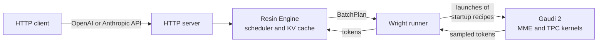

<div align="center">

# Wright

**A new inference engine for Intel Gaudi 2.**


[](https://discord.gg/SXJcQM79j4)

<table>
<tr><th colspan="4">Qwen3.8-27B, one HL-225 card</th></tr>
<tr>
<td align="center"><h3>187 tok/s</h3>decode, 1 request<br><sub>DSpine, code, 8K context</sub></td>
<td align="center"><h3>1,011 tok/s</h3>decode, 64 requests<br><sub>no drafts, 4K context</sub></td>
<td align="center"><h3>5.1K tok/s</h3>prefill<br><sub>4K prompt</sub></td>
<td align="center"><h3>0</h3>compilations after startup<br><sub>from the server log</sub></td>
</tr>
<tr><th colspan="4">GLM-5.3-Flash, 4 HL-225 cards</th></tr>
<tr>
<td align="center"><h3>169 tok/s</h3>decode, 1 request<br><sub>DFlash 2, code, 8K context</sub></td>
<td align="center"><h3>514 tok/s</h3>decode, 64 requests<br><sub>no drafts, 4K context</sub></td>
<td align="center"><h3>3.7K tok/s</h3>prefill<br><sub>8K prompt</sub></td>
<td align="center"><h3>0</h3>compilations after startup<br><sub>from the server log</sub></td>
</tr>
<tr><th colspan="4">DeepSeek-V4.1-Flash, 8 HL-225 cards</th></tr>
<tr>
<td align="center"><h3>182 tok/s</h3>decode, 1 request<br><sub>DSpark-3, code, 8K context</sub></td>
<td align="center"><h3>831 tok/s</h3>decode, 64 requests<br><sub>no drafts, 4K context</sub></td>
<td align="center"><h3>8.2K tok/s</h3>prefill<br><sub>16K prompt</sub></td>
<td align="center"><h3>0</h3>compilations after startup<br><sub>from the server log</sub></td>
</tr>
<tr><th colspan="4">Mistral-Large-4, 8 HL-225 cards (Wright 0.2.0)</th></tr>
<tr>
<td align="center"><h3>74 tok/s</h3>decode, 1 request<br><sub>DSpark-3, 2K context</sub></td>
<td align="center"><h3>263 tok/s</h3>decode, 16 requests<br><sub>no drafts, 2K context</sub></td>
<td align="center"><h3>2.0K tok/s</h3>prefill<br><sub>8K prompt</sub></td>
<td align="center"><h3>0</h3>compilations after startup<br><sub>from the server log</sub></td>
</tr>
</table>

<sub>Wright 0.3.0: <code>scripts/bench.py</code> with sampling, without the HTTP server. The decode values do not include
prefill. Mistral-Large-4: Wright 0.2.0, English text with sampling, through the server. Read
<a href="#performance">Performance</a>.</sub>

[Introduction](#introduction) ·
[Supported models](#supported-models) ·
[What it does](#what-it-does) ·
[Performance](#performance) ·
[How to run it](#how-to-run-it)

</div>

---

## Introduction

Wright is a new inference engine for Intel Gaudi 2.

Why "Wright"? I needed a name, and it was midnight. Gaudi takes its name from Antoni Gaudí.
The only other architect that I could remember was Frank Lloyd Wright.

It just felt Wright.

## Supported models

| Model | Weights | Cards | Status | Tests |
|---|---|---|---|---|
| Qwen3.8-27B | FP8 safetensors | 1 | 🟢 Lab Ready | Throughput sweep, GPQA Diamond |
| Mistral-Large-4 | `UD-Q4_K_XL` GGUF | 8 | 🟡 In Testing | Throughput sweep and GPQA Diamond on 155 of 198 questions, with Wright 0.2.0. Not tested again with Wright 0.3.0 |
| GLM-5.3-Flash | FP8 safetensors | 4 or 8 | 🟢 Lab Ready | Throughput sweep, GPQA Diamond |
| DeepSeek-V4.1-Flash | FP4 and FP8 safetensors | 8 | 🟡 In Testing | Server check, throughput with 1 to 8 requests, GPQA Diamond |
| Qwen3.5-9B | FP8 safetensors from a third party | 1 | 🟡 In Testing | Server check, throughput with 1 and 8 requests |
| Qwen3.5-4B | FP8 safetensors from a third party | 1 | 🟡 In Testing | Server check, throughput with 1 and 8 requests |
| Qwen3.5-2B | FP8 safetensors from a third party | 1 | 🟡 In Testing | Server check, throughput with 1 and 8 requests |
| Qwen3.5-0.8B | FP8 safetensors from a third party | 1 | 🟡 In Testing | Server check, throughput with 1 and 8 requests |
| Qwen3.8-Flash-Next | FP8 safetensors | 4 | 🔴 Bleeding Edge | Early support: text only, contexts up to 2,048 tokens, no prompt logprobs. No server check or throughput sweep |

| Status | Meaning |
|---|---|
| 🟢 **Lab Ready** | The model is ready to serve in a lab. |
| 🟡 **In Testing** | The model works. It needs more throughput sweeps, or a longer test with many requests. |
| 🔴 **Bleeding Edge** | Early support, for example a model before its release or an experimental quantization. Expect problems. |

### Checkpoints

Wright uses these Hugging Face checkpoints at these revisions. The presets in `deploy/models.py` pin the same
revisions for the model weights. All the results in this README come from these checkpoints.

| Model | Hugging Face repository | Revision | Use |
|---|---|---|---|
| Qwen3.8-27B | [`Qwen/Qwen3.8-27B-FP8`](https://huggingface.co/Qwen/Qwen3.8-27B-FP8) | `017b9c7af6b5689d5dd426a76e0bc077eb5ca20a` | Weights, with the MTP layers |
| Qwen3.8-27B | [`incoai/Qwen3.8-27B-DFlash2`](https://huggingface.co/incoai/Qwen3.8-27B-DFlash2) | `015e795645c74b1a0eeef3b570031fb62e769bc5` | DFlash 2 drafter (`-md`) |
| Qwen3.8-27B | [`tencent/Qwen3.8-27B-DSpine-b16`](https://huggingface.co/tencent/Qwen3.8-27B-DSpine-b16) | `5f54174d301dbca65d9aa4448dc47e56732d9a12` | DSpine drafter (`-md`) |
| Qwen3.5-9B | [`surogate/Qwen3.5-9B-FP8`](https://huggingface.co/surogate/Qwen3.5-9B-FP8) | `0d8b9bd14f1e192f0094a3d97b7900b82b475c12` | Weights |
| Qwen3.5-4B | [`surogate/Qwen3.5-4B-FP8`](https://huggingface.co/surogate/Qwen3.5-4B-FP8) | `f69d4910303be8136e8c7adbfa2128999029a554` | Weights |
| Qwen3.5-2B | [`surogate/Qwen3.5-2B-FP8`](https://huggingface.co/surogate/Qwen3.5-2B-FP8) | `c11f46d26e90d3ec37b858163849983c45957d73` | Weights |
| Qwen3.5-0.8B | [`surogate/Qwen3.5-0.8B-FP8`](https://huggingface.co/surogate/Qwen3.5-0.8B-FP8) | `1423a80c469215a6045bd4cdb9f342fcc293d0ea` | Weights |
| Qwen3.5 | `Qwen/Qwen3.5-9B` (or the size that you use) | Not pinned | Optional: the MTP layers, which `scripts/qwen35_mtp_fp8.py` adds. The results in this README do not use them |
| GLM-5.3-Flash | [`zai-org/GLM-5.3-Flash`](https://huggingface.co/zai-org/GLM-5.3-Flash) | `46a050bec13002ad29ee795c16e61cf4fa3c4a9c` | Weights, with the MTP layers |
| GLM-5.3-Flash | [`incoai/GLM-5.3-Flash-DFlash2`](https://huggingface.co/incoai/GLM-5.3-Flash-DFlash2) | `bf582e4eacc1810f76656d1811693ff6c6737d2a` | DFlash 2 drafter (`-md`) |
| DeepSeek-V4.1-Flash | [`deepseek-ai/DeepSeek-V4.1-Flash-1017`](https://huggingface.co/deepseek-ai/DeepSeek-V4.1-Flash-1017) | `1bae0e1088993b9b82de08f59de5be5a34e42170` | Weights, with the DSpark layers |
| Mistral-Large-4 | [`unsloth/Mistral-Large-4-1T-A52B-GGUF`](https://huggingface.co/unsloth/Mistral-Large-4-1T-A52B-GGUF) | `1eb4373d37e76f6e7b4b8efa20e1b1ca40b3b964` | Weights (`UD-Q4_K_XL`) |
| Mistral-Large-4 | [`mistralai/Mistral-Large-4-1T-A52B-NVFP4`](https://huggingface.co/mistralai/Mistral-Large-4-1T-A52B-NVFP4) | `bb6d00fe249b0e876f0cffc6b85014be02de3e68` | Tokenizer and chat template; the DSpark drafter (last shard) |
| Qwen3.8-Flash-Next | [`Qwen/Qwen3.8-Flash-Next-FP8`](https://huggingface.co/Qwen/Qwen3.8-Flash-Next-FP8) | `7fb48d708ca6cd8eeed8f4db0433be18af96984f` | Weights |

## What it does

Wright supports inference on the models in [Supported models](#supported-models).

| Item | Qwen3.8-27B | Mistral-Large-4 | GLM-5.3-Flash | DeepSeek-V4.1-Flash | Qwen3.5 0.8B to 9B | Qwen3.8-Flash-Next |
|---|---|---|---|---|---|---|
| **Preset** | `qwen3_5-gaudi2` | `mistral_large4-gaudi2` | `glm5_3_flash-gaudi2`, `-tp4`, `-256k` | `deepseek_v41-gaudi2` | `qwen3_5-0.8b-gaudi2`, `-2b-`, `-4b-`, `-9b-` | `qwen4_exp-gaudi2-tp4`, `qwen4_exp-gaudi2` (8 cards) |
| **Weights** | FP8 safetensors | `UD-Q4_K_XL` GGUF | FP8 safetensors | FP4 and FP8 safetensors | FP8 safetensors from `surogate` | FP8 safetensors |
| **Cards** | 1, or 2, 4 or 8 with `--ranks` | 8 | 8, or 4 with `-tp4` | 8 | 1 | 4. The 8-card preset is not tested |
| **Default maximum batch** | 64 sequences | 16 sequences | 64 sequences | 64 sequences | 32 sequences | 16 sequences |
| **Default context** | 32,768 tokens | 65,536 tokens | 65,536 tokens, 32,768 with `-tp4`, 262,144 with `-256k` | 131,072 tokens | 32,768 tokens | 2,048 tokens (the maximum) |
| **Speculative decoding** | MTP with 2 draft tokens, on by default. Or the DFlash 2 drafter with up to 7 draft tokens, or the DSpine drafter with up to 15 | DSpark with 3 draft tokens, off by default | MTP with up to 3 draft tokens, off by default. Or the DFlash 2 drafter with up to 7 draft tokens | DSpark from the checkpoint with up to 5 draft tokens on batches of up to 2 sequences, off by default | MTP, off by default. Needs the MTP weights from the official checkpoint | None |
| **Chat recipe** | `qwen3_8` | `mistral_large4` | `glm5_3_flash` | `deepseek_v41` | `qwen3_5`. 0.8B and 2B start with thinking off | `qwen3_8` |

Wright uses the Synapse graph compiler and custom TPC-C kernels directly. The models do not run on
PyTorch. The multi-card presets use CPU-only `torch` for Gloo only: the ranks use Gloo when they start, and
`--step-transport gloo` also sends each step through it. By default, the ranks send each step over Unix sockets. Wright uses [Resin](RESIN.md) for the scheduler, the cache allocator, and the HTTP server.



Wright has these features:

| Feature | Description |
|---|---|
| **One compile phase** | Wright compiles all graphs at startup. Context lengths, device addresses, and sampling values are not part of a graph. |
| **KV cache** | Sequences keep key and value (KV) rows in pages of one paged device arena. |
| **Prefix cache** | A new request can reuse a cached prefix at each prefix cache boundary of the model. |
| **Speculative decoding** | The Qwen models and GLM-5.3-Flash use multi-token prediction (MTP). Qwen3.8-27B and GLM-5.3-Flash can use a DFlash 2 drafter, and Mistral-Large-4 a DSpark drafter. DeepSeek-V4.1-Flash uses the DSpark layers of its checkpoint. Greedy and seeded decoding gives the same tokens as decoding without drafts, except where a model's verify step rounds differently from its decode step (GLM-5.3-Flash with the DFlash 2 drafter, DeepSeek-V4.1-Flash): there the two can part at a near tie. |
| **Multiple cards** | Mistral-Large-4, GLM-5.3-Flash, DeepSeek-V4.1-Flash and Qwen3.8-Flash-Next run one process on each card, and Qwen3.8-27B does with `--ranks`. All processes run the same batch and sample the same tokens. |
| **Card selection** | Each process takes a free card from the `--device` list, and skips busy cards. |
| **Clean stop** | On SIGTERM, the server stops new connections, and requests in flight can finish. |
| **Overlap** | The host starts the next decode step while the card runs the current step. |
| **Sampling on the card** | Wright supports temperature, top-k, top-p, seeds, logprobs, and prompt logprobs. A request that gives no temperature, top-p or top-k uses the values of the checkpoint's `generation_config.json`; without the file, temperature 1.0 and top-p 1.0. `GET /v1/models` shows the defaults in use. |
| **HTTP APIs** | The server has OpenAI Chat Completions and Responses, Anthropic Messages, `/tokenize`, `/metrics`, `/health`, and a chat page. |
| **Chat features** | The chat recipes support tool calls and reasoning effort. |

Wright has these limits:

- Wright has no vision tower. It does not accept images or video.
- The Qwen3.5 models run on one card. Qwen3.8-27B runs on 1, 2, 4 or 8 cards, and on 1 card only with `-f oldqwen`.
- The full Mistral-Large-4 model needs 8 cards. On 4 cards, its weights do not fit in card memory.
- GLM-5.3-Flash needs 4 or 8 cards.
- DeepSeek-V4.1-Flash needs 8 cards.
- A different number of cards can give different tokens for one request. A different set of cards
  with the same number gives the same tokens.
- A sampled token can have a maximum of 64 top logprobs.

> [!CAUTION]
> DO NOT USE WRIGHT IN PRODUCTION. WRIGHT IS NEW SOFTWARE, AND AN ERROR CAN STOP THE SERVER
> OR GIVE INCORRECT TOKENS.

## Performance

The throughput results of Wright 0.3.0 come from [`scripts/bench.py`](scripts/bench.py), with the cross grid
of [`docs/performance.md`](docs/performance.md#the-cross-grid). It loads the model and runs the Engine without the
HTTP server. The prompts are passages of English prose and of source code, with contexts from 2K to 64K. Each
request generates up to 512 tokens, and the benchmark times 512 decode steps. The decode time does not include
prefill. The sampling uses the values of each checkpoint, with thinking off or low reasoning. Each value is from
one run for each text. The results use HL-225 cards, Synapse 1.24.1, and the pinned checkpoints, on 2026-11-15
and 2026-11-16.

- **Prefill** is the prompt tokens per second of one request, with prose.
- **Decode** is the total of generated tokens per second for all requests together, in the form prose / code.
- **No fit** means that the requests do not fit in the KV cache at the same time.
- **†** means that some steps of the cell were slow in each run. The value is the rate without these steps.

> [!NOTE]
> A server that gets requests at the same time prefills some requests while it decodes others. These results do
> not include that prefill time. Refer to [Prefill stops decode for one chunk](#prefill-stops-decode-for-one-chunk).

[`docs/performance.md`](docs/performance.md) has all the results and the commands that make them. The results of
Wright 0.1.0 and 0.2.0 came from a different method, with the HTTP server and llama-benchy, so do not compare them
value for value with these results. They are in [`docs/performance-0.2.0.md`](docs/performance-0.2.0.md).

### Qwen3.8-27B

#### Throughput

These results are from 2026-11-15, on one card. DFlash 2 uses 7 draft tokens, and DSpine up to 15.

**1 request**

| Context | Prefill | No drafts | MTP-2 | DFlash 2 (7) | DSpine (15) |
|---:|---:|---:|---:|---:|---:|
| 2K | 4,935 | 64 / 64 | 99 / 131 | 97 / 166 | 91 / 167 |
| 4K | 5,129 | 64 / 64 | 101 / 124 | 100 / 149 | 96 / 151 |
| 8K | 5,086 | 61 / 61 | 93 / 119† | 85 / 178 | 82 / 187 |
| 16K | 4,810 | 58 / 58 | 85 / 114 | 74 / 152 | 71 / 148 |
| 32K | 4,273 | 57 / 56 | 83 / 106 | 70 / 133 | 68 / 133 |
| 64K | 3,473 | 50 / 50 | 69 / 90 | 56 / 122 | 54 / 119 |

**8 requests**

| Context | No drafts | MTP-2 | DFlash 2 (7) | DSpine (15) |
|---:|---:|---:|---:|---:|
| 2K | 414 / 412 | 510 / 686 | 349 / 714 | 420 / 719 |
| 4K | 386 / 387 | 483 / 604† | 334 / 576 | 399 / 585 |
| 8K | 347 / 348 | 422 / 557† | 332 / 569 | 330 / 543 |
| 16K | 290 / 290 | 351 / 474† | 284 / 515 | 289 / 476 |
| 32K | 219 / 219 | 264 / 354 | 216 / 354 | 219 / 349 |
| 64K | 148 / 147 | 179 / 235 | 140 / 244 | 158 / 243 |

- The values are tok/s.
- On code, the DFlash 2 and DSpine drafters give 2.3 to 3.1 times the rate of no drafts with one request.
- On prose, MTP-2 gives the highest rate. With 4 to 32 requests, DFlash 2 decodes up to 16% slower than no
  drafts (2K, 8 requests), and DSpine up to 5% slower. Refer to
  [Drafts can decrease throughput](#drafts-can-decrease-throughput).
- † In these MTP-2 cells on code, some steps took 0.5 to 1 s in two runs on two cards.
- At 64K, 16 or more requests do not fit in the KV cache of one card.

#### Server check

The last full run of `scripts/check_server.py` was on 2026-11-16, with the stress checks. It gave 13
passed, 0 failed, and 4 skipped checks.

- **Compile stability:** The server did 0 graph compilations after startup.
- **Evaluation:** The model got 92 of 100 questions correct on a seeded MMLU sample.
- **Prefix cache:** A repeated 4,887-token prompt reused 4,096 cached tokens.
- **Skipped checks:** Images, reasoning effort, the exact context limit, and the HTTP compile counter.

#### GPQA Diamond

These results are from 2026-11-02. They use `inspect_evals` 0.27.0, one pass of the 198 questions,
and temperature 0.6. The last column shows the
[Artificial Analysis](https://artificialanalysis.ai/evaluations/gpqa-diamond) score on 2026-11-01.

| Reasoning | Answer token limit | Correct | Score | Standard error | Artificial Analysis |
|---|---:|---:|---:|---:|---:|
| None | 16,384 | 161 of 198 | **81.3%** | ±2.8 | 81.8% |
| Xhigh | 64,000 | 178 of 198 | **89.9%** | ±2.1 | 90.5% |

- **Cut-off answers:** At xhigh, 5 answers reached the limit of 64,000 tokens during reasoning, so
  they gave no answer. The score counts them as incorrect. If all 5 were correct, the score would
  be 92.4%. With no reasoning, no answer reached its limit.
- **Answer length:** At xhigh, the median answer used 7,218 tokens, and the longest complete answer
  used 62,569 tokens. A separate xhigh run with a limit of 16,384 tokens scored 70.7%, because
  55 answers reached the limit. Reasoning at this level needs a large limit.
- **Comparison:** The two sources can use a different prompt, token limit, or number of passes.
  Differences smaller than the standard error do not show a difference between the models.
- **Run settings:** The run with no reasoning used no drafts and 32 requests at the same time. The
  xhigh run used MTP-2 and 8 requests at the same time. The xhigh run stopped after 120 answers,
  because one prompt and the token limit did not fit in 65,536 tokens of context. It continued
  from its saved answers with 131,072 tokens of context.

### Mistral-Large-4

#### Throughput

These results are from Wright 0.2.0, on 2026-11-03, on 8 cards. They use the llama-benchy method of
[`docs/performance-0.2.0.md`](docs/performance-0.2.0.md). Wright 0.3.0 has no new results for this model.
Wright 0.3.0 does not test Mistral-Large-4 again, so its status is In Testing. The next tests will use a
checkpoint with MXFP4 experts.
DSpark-3 uses the drafter with 3 draft tokens.

| Context | Prefill | Decode, 1 request, no drafts | Decode, 1 request, DSpark-3 | Decode, 4 requests, no drafts | Decode, 4 requests, DSpark-3 | Decode, 16 requests, no drafts | Peak, 16 requests, no drafts |
|---:|---:|---:|---:|---:|---:|---:|---:|
| 2K | 1,981 | 48 | **74** | 129 | **141** | 263 | 273 |
| 8K | 2,043 | 43 | **60** | 96 | **104** | 176 | 192 |
| 32K | 1,439 | 35 | **48** | 72 | **79** | 24 | 88 |

- The values are tok/s. The model accepted 52% to 60% of the draft tokens.
- The drafter works on batches of up to 4 sequences, and a larger batch runs without drafts.
  Drafts are off by default. To use them, refer to [Use the DSpark drafter](#use-the-dspark-drafter).
- At 32K with 16 requests, the KV cache held 11 requests at the same time, and the others waited.
- These results replace a sweep from 2026-11-01. That sweep gave low decode rates at 8K and
  longer, for example 15 tok/s for one request at 8K. Other runs did not reproduce those values.

#### Server check

The last full run of `scripts/check_server.py` was on 2026-10-31 at the default settings. It
gave 15 passed, 1 failed, and 3 skipped checks.

- **Failed check:** The evaluation failed because one answer was missing. This request did not
  finish in the 180-second limit of the client.
- **Evaluation:** The model got 92 of 100 questions correct on a seeded MMLU sample.
- **Compile stability:** The server did 0 graph compilations after startup.
- **Long context:** A separate test put one fact into long text. The model found the fact in
  15 of 15 requests, from 1.4K to 48K tokens.
- **KV cache:** The cache holds 380,800 tokens at the default settings.
- **Skipped checks:** The checks for images, the exact context limit, and the HTTP compile
  counter did not run. No prompt above 48K tokens went through the server.

#### GPQA Diamond

A run with high reasoning stopped after 155 of the 198 questions. The model got 142 of the 155
correct (91.6%). The score of the full set is not measured yet. The run used `inspect_evals`
0.27.0, temperature 1.0, top-p 0.95, a limit of 128,000 answer tokens, no drafts, and 3 requests
at the same time. One answer reached the token limit.

### GLM-5.3-Flash

#### Throughput

These results are on 4 cards with the `-tp4` preset and `--step-transport native`. No drafts ran on 2026-11-15,
and MTP-3 and DFlash 2 on 2026-11-16, on the same cards.

**1 request**

| Context | Prefill | No drafts | MTP-3 | DFlash 2 (7) |
|---:|---:|---:|---:|---:|
| 2K | 2,949 | 95 / 95 | 92 / 124 | 88 / 107 |
| 4K | 3,707 | 95 / 94 | 96 / 130 | 89 / 117 |
| 8K | 3,716 | 94 / 94 | 132 / 165 | 92 / 169 |
| 16K | 3,452 | 93 / 93 | 120 / 137 | 87 / 108 |
| 32K | 2,962 | 92 / 93 | 91 / 137 | 89 / 125 |
| 64K | 2,285 | 91 / 91 | 95 / 121 | 86 / 113 |

**8 requests**

| Context | No drafts | MTP-3 | DFlash 2 (7) |
|---:|---:|---:|---:|
| 2K | 324 / 320 | 332 / 333 | 317 / 324 |
| 4K | 320 / 321 | 329 / 328 | 313 / 318 |
| 8K | 316 / 316 | 324 / 325 | 297 / 302 |
| 16K | 305 / 307 | 315 / 316 | 300 / 300 |
| 32K | 297 / 298 | 305 / 305 | 279 / 288 |
| 64K | 284 / 284 | 290 / 291 | 276 / 276 |

- The values are tok/s. With no drafts, the decode rate of one request changes little up to 64K.
- On code with one request, MTP-3 and DFlash 2 give up to 1.8 times the rate of no drafts.
- On prose with one request, MTP-3 gives about the rate of no drafts (1.4 times at 8K and 1.3 times at 16K), and
  DFlash 2 up to 8% less.
- With 8 requests, MTP-3 gives 2 to 4% more than no drafts, and DFlash 2 up to 6% less.
- The results of Wright 0.2.0 on 8 cards are in
  [`docs/performance-0.2.0.md`](docs/performance-0.2.0.md#glm-53-flash-8-cards).

#### Server check

The last full run of `scripts/check_server.py` was on 2026-11-16, with the stress checks. The `wright`
command started the model on 8 cards with no drafts. It gave 13 passed, 0 failed, and 4 skipped checks.

- **Evaluation:** With low reasoning, the model got 91 of 100 questions correct on a seeded MMLU
  sample.
- **Compile stability:** The server did 0 graph compilations after startup.
- **Prefix cache:** A repeated 4,840-token prompt reused 4,096 cached tokens.
- **Skipped checks:** Images, reasoning effort, the exact context limit, and the HTTP compile counter.
- **Long context:** In a separate test on 2026-10-31, the model found a fact in long text in 15 of
  15 requests, up to 38K tokens. With the `-256k` preset, it found the fact in 10 of 10 requests at
  128K and 256K.

#### GPQA Diamond

These results are from 2026-11-02. They use `inspect_evals` 0.27.0, one pass of the 198 questions,
and the model's default reasoning, which is Max. The last column shows the
[Artificial Analysis](https://artificialanalysis.ai/evaluations/gpqa-diamond) score on 2026-11-01.

| Temperature | Top-p | Answer token limit | Correct | Score | Standard error | Artificial Analysis |
|---:|---:|---:|---:|---:|---:|---:|
| 1.0 | 0.95 | 64,000 | 174 of 198 | **87.9%** | ±2.3 | 91.2% |
| 0.6 | Not set | 64,000 | 158 of 198 | 79.8% | ±2.9 | |

- **Sampling:** Temperature 1.0 and top-p 0.95 are the values in the model's
  `generation_config.json`. Use these values. At temperature 0.6, 25 answers reached the limit, and
  22 of them ended in repeated text. At temperature 1.0, 8 answers reached the limit, and 1 of them
  ended in repeated text.
- **Cut-off answers:** The score counts the 8 answers at temperature 1.0 as incorrect. If all 8 were
  correct, the score would be 91.9%.
- **Answer length:** At temperature 1.0, the median answer used 4,350 tokens, and the longest
  complete answer used 60,814 tokens. Of the 198 answers, 37 used more than 16,384 tokens.
- **Comparison:** Artificial Analysis uses temperature 0.6 for reasoning models, unless the model
  lab recommends a different value. It does not state the value for this model. The two sources
  can also use a different prompt, token limit, or number of passes.
- **Run settings:** Both runs used 8 cards, no drafts, 16 requests at the same time, and 131,072
  tokens of context.

### DeepSeek-V4.1-Flash

#### Throughput

These results are from 2026-11-15, on 8 cards, with no drafts and with DSpark-3.

**1 request**

| Context | Prefill | No drafts | DSpark-3 |
|---:|---:|---:|---:|
| 2K | 5,377 | 116 / 116 | 130 / 174 |
| 4K | 6,951 | 115 / 115 | 139 / 168 |
| 8K | 7,819 | 114 / 114 | 146 / 182 |
| 16K | 8,243 | 113 / 113 | 140 / 175 |
| 32K | 8,216 | 112 / 112 | 140 / 163 |
| 64K | 7,927 | 109 / 109 | 127 / 168 |

**8 requests**

| Context | No drafts | DSpark-3 |
|---:|---:|---:|
| 2K | 469 / 469 | 469 / 469 |
| 4K | 466 / 465 | 466 / 465 |
| 8K | 457 / 457 | 457 / 457 |
| 16K | 450 / 449 | 450 / 449 |
| 32K | 437 / 436 | 437 / 436 |
| 64K | 414 / 415 | 414 / 415 |

- The values are tok/s. DSpark runs only on decode steps of 2 sequences or fewer. Thus, with 8 requests, DSpark-3
  decodes with no drafts.
- With one request, DSpark-3 gives 1.1 to 1.3 times the rate of no drafts on prose and 1.5 to 1.6 times on code.
- Prefill is 7,800 tok/s or more from 8K to 64K. The server computes layers 20 to 39 only for the last 256
  positions of each prompt (bounded replay). The other positions get their keys for these layers from layer 20.
  This is an approximation of the full model. To compute all positions in all layers, set `RESIN_DS41_REPLAY=0`
  before you start the server.

#### Server check

The last full run of `scripts/check_server.py` was on 2026-11-16, with 131,072 tokens of context and
the stress checks. It gave 14 passed, 0 failed, and 3 skipped checks.

- **Evaluation:** With low reasoning, the model got 93 of 100 questions correct on a seeded MMLU sample.
- **Compile stability:** The server did 0 graph compilations after startup.
- **Context limit:** The check of the exact context limit of 131,072 tokens passed.
- **Prefix cache:** The check passed. In a separate test, a 29K-token prompt got its first token in
  8.25 s. The same prompt got its first token in 0.29 s the second time.
- **Skipped checks:** Images, reasoning effort, and the HTTP compile counter.

#### GPQA Diamond

These results are from 2026-11-06. They use `inspect_evals` 0.27.0, one pass of the 198 questions,
and Max reasoning.

| Reasoning | Temperature | Top-p | Answer token limit | Correct | Score | Standard error |
|---|---:|---:|---:|---:|---:|---:|
| Max | 1.0 | 1.0 | 262,144 | 187 of 198 | **94.4%** | ±1.6 |

- **Sampling:** The `README.md` of the checkpoint recommends temperature 1.0, top-p 1.0, and a limit
  of 256K answer tokens or more. The run used these values.
- **Cut-off answers:** No answer reached the limit. The model completed all 198 answers.
- **Answer length:** The median answer used 7,830 tokens, and the longest answer used 93,622 tokens.
  Of the 198 answers, 60 used more than 16,384 tokens. With a limit of 64,000 tokens, as in the
  Qwen3.8-27B and GLM-5.3-Flash runs, 8 answers would reach the limit.
- **Scorer:** One answer ended with `ANSWER: $B`. The scorer found no letter in this answer, and
  counted it as incorrect. B was the correct letter. If the scorer accepted this answer, the score
  would be 94.9%.
- **Comparison:** Artificial Analysis and the `README.md` of the checkpoint give no GPQA Diamond
  score for this model.
- **Run settings:** The run used 8 cards, DSpark-3, and 2 requests at the same time. DSpark runs
  only on decode steps of 2 sequences or fewer. Thus, it ran on each decode step. The server used
  512,000 tokens of context, a batch of 8 (`-np 8`), and `--decode-share 25:99`.
- **Duration:** The run took 4 h 48 min. On average, the 2 requests generated approximately
  170 tok/s in total.

### Qwen3.5 0.8B to 9B

#### Throughput

These results are from 2026-11-15, on one card, one model after the other, with no drafts. The values are tok/s
on prose. The values on code are within 10% of them.

| Model | Prefill, 8K | Prefill, 64K | Decode 8K, 1 request | Decode 8K, 8 requests | Decode 64K, 1 request | Decode 64K, 8 requests |
|---|---:|---:|---:|---:|---:|---:|
| Qwen3.5-9B | 14,571 | 9,936 | 162 | 882 | 127 | 336 |
| Qwen3.5-4B | 18,540 | 11,576 | 229 | 1,113 | 165 | 366 |
| Qwen3.5-2B | 38,571 | 26,694 | 421 | 2,158 | 316 | 832 |
| Qwen3.5-0.8B | 47,240 | 30,430 | 588 | 2,634 | 400 | 898 |

#### Server check

The `wright` command started each model, and `scripts/check_server.py` ran against it on 2026-11-16.
Each model gave 13 passed, 1 failed, and 3 skipped checks.

- **Passed checks:** Chat, logprobs, and concurrent requests. Prompts of up to 16K words, and the
  exact context limit of 32,768 tokens. The prefix cache. The stress checks with 1, 4, and 16
  requests, invalid input, and recovery.
- **Failed check:** The MMLU evaluation fails if an answer is missing or cut off, or if fewer than
  50 are correct. The 9B and 4B models think first. Some of their answers did not finish in the
  180-second limit of the client, and some reached the limit of 16,384 tokens. The 2B and 0.8B
  models sometimes write the answer in a form that the check does not read. The 0.8B model got
  fewer than 50 correct.
- **Skipped checks:** Images, reasoning effort, and the HTTP compile counter.

| Model | MMLU, correct of 100 | Missing answers |
|---|---:|---:|
| Qwen3.5-9B | 81 | 8 |
| Qwen3.5-4B | 76 | 12 |
| Qwen3.5-2B | 71 | 1 |
| Qwen3.5-0.8B | 45 | 6 |

For more detail, read [`models/gaudi/README.md`](models/gaudi/README.md).

## Caveats

### Prefill stops decode for one chunk

A launch does prefill or decode, not both. While a new prompt prefills, the sequences in decode stop.
If no batch position is free, decode continues and the new prompt waits.

Wright divides the card time between prefill and decode. After each prefill chunk, decode runs for
its share of the time before the next chunk starts. Thus, a stream stops for one prefill chunk at a
time, not for the full prefill.

- With a decode share s, a prefill chunk of P seconds gives decode P × s / (1 − s) seconds before the
  next chunk. If decode runs longer, the next chunks give it less. When only prefill or only decode has
  work, Wright starts the count again.
- The time of a launch is the time from its start to its end on the host. When a launch starts before
  the launch before it ends, its time starts at that end.
- Each model of a server has its own division. Refer to
  [How the models share the card time](#how-the-models-share-the-card-time).

- `--decode-share MIN:MAX` sets the share of decode. The share is MIN with no sequence in decode.
  It increases to MAX when all batch positions decode. A larger share keeps the streams fast, but
  the new prompt gets its first token later.
- `-b` sets the tokens per prefill chunk. A smaller chunk gives a shorter stop, but prefill is
  slower.

With `--decode-share 0`, Wright runs the full prefill of a new prompt before decode continues.
Request priority does not change this order. The stop is then as long as the full prefill.

The table shows the results of `scripts/gap_bench.py` on Qwen3.8-27B with one card. 15 streams decode
with MTP-2, and then one prompt arrives. With 15 of 32 batch positions in decode, `50:90` gives decode
69% of the card time. The longest gap is the longest time between two chunks of one stream while the
prompt prefills. With no prefill, the median gap is 40 to 53 ms.

| Prompt length | Setting | Longest gap | Time to first token |
|---:|---|---:|---:|
| 6.4K tokens | `--decode-share 0 -b 4096` | 1.4 s | 1.4 s |
| 6.4K tokens | `--decode-share 50:90 -b 4096` | 0.92 s | 3.3 s |
| 6.4K tokens | `--decode-share 50:90 -b 1024` | 0.37 s | 4.5 s |
| 13K tokens | `--decode-share 0 -b 4096` | 2.9 s | 3.1 s |
| 13K tokens | `--decode-share 50:90 -b 4096` | 1.1 s | 9.0 s |
| 13K tokens | `--decode-share 50:90 -b 1024` | 0.42 s | 9.3 s |
| 26K tokens | `--decode-share 0 -b 4096` | 6.6 s | 6.9 s |
| 26K tokens | `--decode-share 50:90 -b 4096` | 1.4 s | 20 s |
| 26K tokens | `--decode-share 50:90 -b 1024` | 0.62 s | 21 s |

While the prompt prefills, each stream continues at 11 to 14 tok/s with `50:90`, and below 2 tok/s
with `0`. A fixed load of 15 streams with 1500 tokens each and three 13K prompts took 37.4 s with
`50:90` and 36.4 s with `0`. Thus, the time division costs approximately 3% of the total throughput.
At `-b 1024`, the same load took 37.9 s and 36.9 s.

On Mistral-Large-4 with 8 cards, 2048-token prefill launches, and `--decode-share 0`, the longest gap
was 3.7 s, 7.3 s, and 17 s for 6.4K, 13K, and 26K tokens.

With more than one request, the decode results in [Performance](#performance) include these stops,
because llama-benchy sends all requests at the same time. The results for one request and the
`scripts/bench.py` results below do not include them.

### Drafts can decrease throughput

Speculative decoding adds work to each step. Drafts help when few sequences are active and the model
accepts many drafts. In a large batch, they can decrease the total throughput. Thus, some models use
drafts only for some steps:

- Qwen3.8-27B uses plain decoding on batches of more than 32 sequences. Refer to the Qwen3.8-27B
  part below.
- GLM-5.3-Flash selects drafts or plain decoding for each decode step, with MTP and with the DFlash 2
  drafter. With MTP, it uses drafts only on batches of up to 16 verified columns, for example up to 5
  sequences with 2 draft tokens. Refer to the GLM-5.3-Flash part below.
- Mistral-Large-4 and DeepSeek-V4.1-Flash use drafts only on small batches.

On prose with 4 to 32 requests, Qwen3.8-27B decodes up to 16% slower with the DFlash 2 drafter than with no
drafts, and up to 5% slower with the DSpine drafter. MTP-2 is the best choice for prose.

**How GLM-5.3-Flash selects drafts.** For each sequence, the server keeps the average number of drafts that
the sequence accepted in its last verify steps (about the last 5). A new sequence starts at the average of all
sequences. While the server runs, it also measures the time of a plain step and of a verify step for each batch
size. A decode step uses drafts only when they give more tokens per millisecond than a plain step:

- A verify step gives one token for each sequence, plus the average accepted drafts of the sequence, in the time
  of a verify step.
- A plain step gives one token for each sequence in the time of a plain step.

A batch that uses drafts keeps them until plain steps are 10% faster.

- After a run of plain steps, 4 steps use drafts again (a probe), because a sequence that decodes plainly
  gives no new acceptance. A probe gives fewer tokens than plain steps in the same time. The run of plain
  steps before a probe is long enough that this loss is at most 5% of the tokens of the run. Thus the probes
  come frequently when the average accepted drafts are near the break-even point, and less frequently when the
  average is much lower. For example, with MTP (3) on one sequence on 4 cards, a probe comes after 26 plain
  steps when the sequence accepted 0.7 drafts in each step (the break-even point is 0.85), and after 68 plain
  steps when it accepted no drafts. The probes do not become less frequent after probes that found drafts
  slower, because the text can change to text that the drafter predicts well. A batch size where drafts
  cannot give more tokens, even if the model accepts all of them, has no probes.
- All the cards of the model must select the same kind of step. With `--step-transport native`, the first
  card selects the kind of step for all the cards, with its step times, and sends its selection with each
  step. With the other transports, each card selects with the step times of the first card, which it sends
  to the other cards after 32, 64 and 128 decode steps, and then after each 256 steps.
- With the DFlash 2 drafter, a plain step also writes the drafter's cache, so that the later drafts of the
  sequence see all of its tokens. This makes a plain step about 3% slower than on a server with no drafter.
- To use drafts in each step, set `RESIN_GLM_DRAFT_POLICY=always` before you start the server. To stop
  drafts, set `RESIN_GLM_DRAFT_POLICY=never`, or use `--spec-draft-n-max 0`.
- A verify step and a plain step can give a different greedy token at the same position. In the runs below,
  the greedy output with drafts in each step was the same with MTP and with the DFlash 2 drafter, and it
  differed from the output with no drafts after 15 to 108 characters. Thus the greedy output can change when
  the server changes the kind of step.

The table shows the rates through the server of GLM-5.3-Flash on 4 cards, greedy, with
`"reasoning_effort": "low"`. The first rows are one request of each kind of
[output](#drafts-by-kind-of-output). Then come N requests at the same time that ask for code (N code), and N
requests of which half ask for code and half for a story (N mixed), with 320 output tokens each.

| Work | No drafts | DFlash 2 (7) in each step | DFlash 2 (7), selected | MTP (3) in each step | MTP (3), selected |
|---|---:|---:|---:|---:|---:|
| 1 code | 99.5 | 218 | 217 | 175 | 174 |
| 1 JSON | 99.5 | 225 | 224 | 182 | 182 |
| 1 edit | 99.2 | 284 | 283 | 192 | 192 |
| 1 story | 99.5 | 80.3 | 96.8 | 107 | 97.6 |
| 2 code | 163 | 224 | 223 | 227 | 221 |
| 4 code | 238 | 230 | 223 | 287 | 280 |
| 8 code | 313 | 227 | 311 | 320 | 320 |
| 16 code | 391 | 210 | 364 | 393 | 393 |
| 2 mixed | 162 | 129 | 149 | 162 | 158 |
| 4 mixed | 239 | 143 | 218 | 219 | 226 |
| 8 mixed | 318 | 141 | 306 | 326 | 316 |

With the DFlash 2 drafter, the selection gave up to 2.2 times the rate of drafts in each step, and its rate
is within 9% of the better of drafts in each step and no drafts. With MTP, a story accepts drafts near the
point where they pay. The server then uses plain steps for most of the story, which is 9% slower than drafts
in each step.

The tables show tok/s from `scripts/bench.py` with sampling at 8K context, in the form English / code.
Each value is the range from two seeds. This benchmark runs the engine without the HTTP server, and
its decode time does not include prefill. Thus, its values are higher than the decode values in
[Performance](#performance).

**GLM-5.3-Flash on 8 cards.** GLM-5.3-Flash starts with no drafts. If you send one request at a time,
use `--spec-draft-n-max 1`. The table shows the rates from before MTP used plain decoding on large
batches. At batch size 16, MTP-2 now uses plain decoding. Through the server with `-np 64`, MTP-2 gave
630 tok/s with 16 requests and 906 tok/s with 64 requests. Without drafts, the server gave 638 and
927 tok/s.

| Batch size | No drafts | 1 draft token | 2 draft tokens | 3 draft tokens |
|---:|---:|---:|---:|---:|
| 1 | 95 / 91-97 | 122-134 / 132-141 | 103-135 / 140-143 | 97-128 / 143-158 |
| 4 | 280-281 / 280-290 | Not measured | 187-200 / 252-262 | Not measured |
| 16 | 492 / 492-493 | 314-323 / 377-379 | 220-228 / 307-309 | 180-193 / 301-303 |

**Qwen3.8-27B on 1 card.** Qwen3.8-27B starts with 2 draft tokens and a maximum batch of 64
sequences. A step with up to 32 sequences uses drafts. A step with more than 32 sequences uses plain
decoding. The result changes with the text, because the model accepts more drafts on code.

By default (`RESIN_QWEN_DRAFT_POLICY=auto`), a decode step uses drafts only when they give more tokens
per millisecond than plain decoding at that batch size. The server measures both kinds of step while it
runs. To use drafts in every step of up to 32 sequences, set `RESIN_QWEN_DRAFT_POLICY=always` before you
start the server. To stop drafts for all steps, set `RESIN_QWEN_DRAFT_POLICY=never`, or use
`--spec-draft-n-max 0`.

The table shows tok/s from `scripts/bench.py` with sampling at 8K context and one seed, in the form
English / code, with the default policy. All the values come from one card, one value after the other.
The DFlash 2 drafter verified 7 draft tokens, and the DSpine drafter up to 15.

| Batch size | No drafts | MTP with 2 draft tokens | DFlash 2 with 7 draft tokens | DSpine with 15 draft tokens |
|---:|---:|---:|---:|---:|
| 1 | 61 / 61 | 96 / 98 | 113 / 98 | 110 / 95 |
| 8 | 326 / 326 | 371 / 365 | 338 / 324 | 366 / 369 |
| 16 | 494 / 494 | 495 / 515 | 429 / 449 | 471 / 473 |
| 32 | 628 / 630 | 600 / 635 | 517 / 552 | 594 / 586 |
| 48 | 660 / 659 | Plain decoding | Plain decoding | Plain decoding |
| 64 | 780 / 779 | Plain decoding | Plain decoding | Plain decoding |

- At 1 request, every drafter gives the same rate as drafts in every step (`always`).
- At 16 and 32 requests, DFlash 2 and DSpine decode mostly without drafts. Drafts in every step
  gave 390 to 425 tok/s with DFlash 2 and 474 to 538 with DSpine at those batch sizes.
- After a run of plain steps, the server tries drafts again for a few steps. In a short benchmark
  (100 steps for each batch size) these tries cost up to 18% at 32 requests. In a server that runs for a
  long time, they come less often: after up to 512 plain steps (by calculation, approximately 1%; not
  measured).

On one card, 64 sequences at 8K context fill the KV cache:

- Without drafts, 64 sequences at 8K context need `--gpu-memory-utilization 0.95`.
- With MTP, 64 sequences at 8K context do not fit. The server then holds fewer sequences at the same
  time, and the other requests wait.

**Mistral-Large-4 on 8 cards.** The drafter works on batches of up to 4 sequences, and a larger batch
runs without drafts. Drafts are off by default. In this benchmark, 3 draft tokens did not increase the
English rate at batch size 4. Through the server, DSpark-3 increased the decode rate at 1 and 4
requests. Refer to [Mistral-Large-4](#mistral-large-4).

| Batch size | No drafts | 3 draft tokens |
|---:|---:|---:|
| 1 | 43 / 42 | 55 / 57-62 |
| 4 | 94 / 94 | 90-92 / 112-114 |

### Drafts by kind of output

The gain from drafts changes with the text. The model accepts many drafts on code, JSON, and edits that copy
their input, and few on a free story. The tables show the decode rate through the server for one request at a
time: greedy, 512 output tokens, the median of 3 requests. The prompts ask for:

- code: a Python module with a class, docstrings, type hints and tests;
- JSON: 12 records of 9 fields;
- edit: the same 50-line Python file with type hints added (the answer copies most of the prompt);
- story: a long story.

Qwen3.8-27B ran with `"enable_thinking": false`, and GLM-5.3-Flash with `"reasoning_effort": "low"` (at most 3%
of its output was reasoning).

**Qwen3.8-27B on 1 card** (tok/s):

| Output | No drafts | MTP with 2 draft tokens | DFlash 2 with 7 draft tokens | DSpine with 15 draft tokens |
|---|---:|---:|---:|---:|
| Code | 64.1 | 136.9 | 168.3 | 139.0 |
| JSON | 64.1 | 143.5 | 212.8 | 184.7 |
| Edit | 63.2 | 140.3 | 225.5 | 237.4 |
| Story | 64.1 | 117.5 | 96.2 | 62.1 |

**GLM-5.3-Flash on 4 cards** (tok/s):

| Output | No drafts | MTP with 3 draft tokens | DFlash 2 with 7 draft tokens |
|---|---:|---:|---:|
| Code | 99.5 | 175.6 | 218.6 |
| JSON | 99.4 | 182.4 | 228.1 |
| Edit | 99.2 | 191.7 | 282.3 |
| Story | 99.5 | 106.2 | 80.6 |

These GLM-5.3-Flash rates use drafts in each step. By default, the server now selects drafts or plain decoding
for each step: refer to [Drafts can decrease throughput](#drafts-can-decrease-throughput).

**DeepSeek-V4.1-Flash on 8 cards** (tok/s):

| Output | No drafts | DSpark with 3 draft tokens |
|---|---:|---:|
| Code | 117.2 | 201.5 |
| JSON | 116.8 | 221.7 |
| Edit | 112.0 | 224.2 |
| Story | 117.2 | 132.5 |

- MTP increases the rate for every kind of output.
- The larger drafters (DFlash 2 and DSpine) give the most on code, JSON and edits: up to 3.8 times the rate
  without drafts. On a story they can be slower than no drafts.
- These rates are for one request at a time. With more requests, the models use drafts on fewer steps (see
  above).

### Greedy output can change with drafts

On GLM-5.3-Flash and DeepSeek-V4.1-Flash, a verify step and a plain step can give a different greedy token at
a near tie. The kind of step depends on the other requests in the batch and, on GLM-5.3-Flash, on the measured
step times. Thus, with drafts, two runs of the same greedy request can give different output.

### DeepSeek-V4.1-Flash approximates long prompts

DeepSeek-V4.1-Flash computes layers 20 to 39 only for the last 256 positions of each prompt (bounded replay).
This is an approximation of the full model. To compute all positions in all layers, set `RESIN_DS41_REPLAY=0`
before you start the server. Refer to [DeepSeek-V4.1-Flash](#deepseek-v41-flash).

### Mistral-Large-4 was not tested again

Wright 0.3.0 did not test Mistral-Large-4 again. Its results are from Wright 0.2.0. Refer to
[Mistral-Large-4](#mistral-large-4).

## How to run it

### Prerequisites

You must have these items. For the exact packages, and for the items that you do not need, read
[`docs/install.md`](docs/install.md).

| Item | Value |
|---|---|
| **Cards** | 1 free Gaudi 2 card for Qwen3.8-27B, 8 for Mistral-Large-4, 4 or 8 for GLM-5.3-Flash (the tests used HL-225) |
| **Gaudi driver** | `habanalabs-dkms` and `habanalabs-firmware` |
| **Synapse API** | `habanalabs-graph`: `libSynapse.so`, `synapse_api.h`, and HCCL (the tests used Synapse 1.24.1) |
| **TPC-C compiler** | `tpc-clang`, in `habanalabs-tools`, which builds the kernels (the tests used 2.7.33) |
| **Host tools** | `gcc`, `g++`, Python 3.11 or later, [`rustup`](https://rustup.rs), and [`uv`](https://docs.astral.sh/uv/) |
| **Disk** | 29 GB for Qwen3.8-27B, 306 GiB for GLM-5.3-Flash, or 564 GiB for Mistral-Large-4 |
| **Host memory** | The Mistral-Large-4 tests used 125 GB |

Wright keeps Resin in this repository, so you do not install it. You do not need the Intel Gaudi
PyTorch packages.

### Start Qwen3.8-27B

1. Get the source code:

   ```bash
   git clone https://github.com/abotsis/wright.git
   cd wright
   ```

2. Download the pinned checkpoint:

   ```bash
   uv run --no-default-groups --group gaudi hf download Qwen/Qwen3.8-27B-FP8 \
     --revision 017b9c7af6b5689d5dd426a76e0bc077eb5ca20a \
     --local-dir ~/models/Qwen3.8-27B-FP8
   ```

3. Start the server:

   ```bash
   uv run --no-default-groups --group gaudi wright -m ~/models/Qwen3.8-27B-FP8
   ```

4. Wait for the `qwen3_5-gaudi2 is ready at http://127.0.0.1:8080` line. With the kernels and
   recipes in the cache, startup takes approximately 1 minute. The first start also builds them,
   so it takes longer. The server shows the progress of the weight load.

5. Open <http://127.0.0.1:8080> for the chat page, or send a request:

   ```bash
   curl http://127.0.0.1:8080/v1/chat/completions \
     -H 'Content-Type: application/json' \
     -d '{
       "model": "Qwen/Qwen3.8-27B-FP8",
       "messages": [{"role": "user", "content": "Who was Antoni Gaudí?"}],
       "max_tokens": 256
     }'
   ```

6. Press Ctrl-C to stop the server. The server shows the number of compilations after startup.

> [!NOTE]
> The `gaudi` group installs only what the server and the benchmark need. The default group
> also installs the development and test tools.

> [!WARNING]
> DO NOT SET `--host 0.0.0.0` ON AN OPEN NETWORK. THE SERVER HAS NO AUTHENTICATION, SO ANY
> USER ON THE NETWORK CAN SEND REQUESTS TO YOUR CARD.

### Start Mistral-Large-4

1. Get the source code. Use step 1 of [Start Qwen3.8-27B](#start-qwen38-27b).

2. Download the pinned weights:

   ```bash
   uv run --no-default-groups --group gaudi hf download unsloth/Mistral-Large-4-1T-A52B-GGUF \
     --revision 1eb4373d37e76f6e7b4b8efa20e1b1ca40b3b964 \
     --include 'UD-Q4_K_XL/*.gguf' \
     --local-dir ~/models/Mistral-Large-4-1T-A52B-GGUF
   ```

3. Download the pinned tokenizer:

   ```bash
   uv run --no-default-groups --group gaudi hf download mistralai/Mistral-Large-4-1T-A52B-NVFP4 \
     --revision bb6d00fe249b0e876f0cffc6b85014be02de3e68 \
     --include 'tokenizer*.json' --include chat_template.jinja --include params.json \
     --local-dir ~/models/Mistral-Large-4-tokenizer
   ```

4. Start the server:

   ```bash
   uv run --no-default-groups --group gaudi wright -m ~/models/Mistral-Large-4-1T-A52B-GGUF \
     --tokenizer ~/models/Mistral-Large-4-tokenizer
   ```

5. Wait for the `mistral_large4-gaudi2 on 8 cards is ready at http://127.0.0.1:8080` line.
   Startup takes approximately 8 minutes, and the server shows the progress of the weight load.

6. Send a request with the model name `unsloth/Mistral-Large-4-1T-A52B-GGUF`:

   ```bash
   curl http://127.0.0.1:8080/v1/chat/completions \
     -H 'Content-Type: application/json' \
     -d '{
       "model": "unsloth/Mistral-Large-4-1T-A52B-GGUF",
       "messages": [{"role": "user", "content": "Who was Antoni Gaudí?"}],
       "max_tokens": 256
     }'
   ```

7. Press Ctrl-C to stop the server.

### Start GLM-5.3-Flash

1. Get the source code. Use step 1 of [Start Qwen3.8-27B](#start-qwen38-27b).

2. Download the pinned checkpoint:

   ```bash
   uv run --no-default-groups --group gaudi hf download zai-org/GLM-5.3-Flash \
     --revision 46a050bec13002ad29ee795c16e61cf4fa3c4a9c \
     --local-dir ~/models/GLM-5.3-Flash
   ```

3. Start the server. To use 4 cards, add `--ranks 4`. For a context of 262,144 tokens, add
   `-c 262144`:

   ```bash
   uv run --no-default-groups --group gaudi wright -m ~/models/GLM-5.3-Flash
   ```

4. Wait for the `glm5_3_flash-gaudi2 on 8 cards is ready at http://127.0.0.1:8080` line.

5. Send a request with the model name `zai-org/GLM-5.3-Flash`.

### Start DeepSeek-V4.1-Flash

1. Get the source code. Use step 1 of [Start Qwen3.8-27B](#start-qwen38-27b).

2. Download the pinned checkpoint. It is 475 GiB:

   ```bash
   uv run --no-default-groups --group gaudi hf download deepseek-ai/DeepSeek-V4.1-Flash-1017 \
     --revision 1bae0e1088993b9b82de08f59de5be5a34e42170 \
     --local-dir ~/models/DeepSeek-V4.1-Flash-1017
   ```

3. Start the server. For DSpark speculative decoding, add `--spec-draft-n-max 3`:

   ```bash
   uv run --no-default-groups --group gaudi wright -m ~/models/DeepSeek-V4.1-Flash-1017
   ```

4. Wait for the `deepseek_v41-gaudi2 on 8 cards is ready at http://127.0.0.1:8080` line.
   Startup takes approximately 13 minutes from an NVMe disk. The server shows the progress of the
   weight load.

5. Send a request with the model name `deepseek-ai/DeepSeek-V4.1-Flash-1017`.

### Start a Qwen3.5 dense model

These steps use Qwen3.5-9B. For a different size, change `9B` in the commands to `4B`, `2B`, or `0.8B`.
Wright finds the preset from the checkpoint.

1. Get the source code. Use step 1 of [Start Qwen3.8-27B](#start-qwen38-27b).

2. Download the pinned checkpoint:

   ```bash
   uv run --no-default-groups --group gaudi hf download surogate/Qwen3.5-9B-FP8 \
     --revision 0d8b9bd14f1e192f0094a3d97b7900b82b475c12 \
     --local-dir ~/models/Qwen3.5-9B-FP8
   ```

   The pinned revisions are in `deploy/models.py`:

   | Size | Revision |
   |---|---|
   | 9B | `0d8b9bd14f1e192f0094a3d97b7900b82b475c12` |
   | 4B | `f69d4910303be8136e8c7adbfa2128999029a554` |
   | 2B | `c11f46d26e90d3ec37b858163849983c45957d73` |
   | 0.8B | `1423a80c469215a6045bd4cdb9f342fcc293d0ea` |

3. Start the server:

   ```bash
   uv run --no-default-groups --group gaudi wright -m ~/models/Qwen3.5-9B-FP8
   ```

4. Wait for the `qwen3_5-9b-gaudi2 is ready at http://127.0.0.1:8080` line.

5. Send a request with the model name `surogate/Qwen3.5-9B-FP8`.

**Speculative decoding.** These checkpoints do not have the MTP weights, so drafts are off. To add the
MTP weights from the official BF16 checkpoint, run this script once. It reads only the MTP tensors:

```bash
uv run --no-default-groups --group gaudi scripts/qwen35_mtp_fp8.py \
  --source Qwen/Qwen3.5-9B --output ~/models/Qwen3.5-9B-FP8
```

Then add `--spec-draft-n-max 2` to the server command.

### Serve several models

Give `-m` more than once. One server then serves all the models on one port.

- `GET /v1/models` lists each model. A request goes to the model that its `model` field names. A
  request for another name gets HTTP 404 with the names that the server serves.
- The flags after an `-m` are the flags of that model, up to the next `-m`. Give the name of each model in
  the API with `-a` after its `-m`.

The `-dev` flags set where the models run:

| Layout | `-dev` | Example |
|---|---|---|
| [Several models on one card](#serve-several-models-on-one-card) | None, or one list before the first `-m` | Qwen3.8-27B and Qwen3.5-0.8B on one card |
| [Models on cards of their own](#serve-models-on-cards-of-their-own) | One list after each `-m`, with no card in two lists | GLM-5.3-Flash on 4 cards, and Qwen3.8-27B replicas on 4 other cards |
| [Replicas on the cards of a multi-card model](#serve-replicas-on-the-cards-of-a-multi-card-model) | One list after each `-m`. The cards of a replica model are cards of the first model. | DeepSeek-V4.1-Flash on 8 cards, and a Qwen3.5-9B replica on each of these cards |

#### Flags with several models

The flags of a model come after its `-m`, up to the next `-m`. A model flag before the first `-m` applies to
every model. A model flag after an `-m` replaces it for that model. A server flag can come anywhere, but
only one time.

```bash
uv run --no-default-groups --group gaudi wright --port 8080 -c 32768 \
  -m ~/models/DeepSeek-V4.1-Flash -a ds --ranks 8 -dev 0-7 -c 131072 --spec-draft-n-max 3 \
  -m ~/models/Qwen3.5-9B-FP8 -a q9 -dev 0-7
```

In this example, DeepSeek-V4.1-Flash has a context of 131,072 tokens and 3 DSpark draft tokens. The
Qwen3.5-9B replicas have a context of 32,768 tokens and no drafts.

| Flag | For | With several models |
|---|---|---|
| `-a`, `--alias` | Each model | Each model must have a different name. |
| `-c`, `-np`, `-b` | Each model | On a shared KV cache, each model keeps the KV cache of one sequence at its own `-c`. |
| `--spec-draft-n-max`, `-md` | Each model | For example, a drafter for the first model and no drafts for the replicas. |
| `-ctk`, `-ctv` | Each model | For example, an `fp8` KV cache for the Qwen replicas beside DeepSeek-V4.1-Flash. |
| `--no-cache-prompt`, `--no-overlap`, `--decode-share` | Each model | |
| `--tokenizer` | Each model | |
| `-dev`, `--device` | Each model | A list after each `-m` puts the models on cards of their own, or puts replicas on the cards of the first model. With no list after the `-m` flags, all the models go on one card. |
| `--ranks` | Each model | Only the first model can use more than one card. |
| `--share` | Each model | Sets the weight of the model in the card time. The default is 1 for each model on one card. For replicas on the cards of the first model, the default is 1 for the first model and 0 for the replicas. |
| `--kv-floor` | Each model | Only for several models on one card. |
| `--gpu-memory-utilization` | Each model, with limits | On one card, it is the part of the card's memory for all the models: give it before the first `-m`. For a replica model on the cards of the first model, it is a fixed part of the memory of each card for each replica. Before the first `-m`, it applies to each replica model. The first model of a layout cannot take it: it makes its KV cache from the memory that is left. |
| `-o`, `--optimize` | The server | Only for replicas on the cards of the first model. |
| The other flags | The server | For example: `--host`, `--port`, `--numa`, `--step-transport`, `--drain-timeout`, and the log flags. |

#### How the models share the card time

Wright divides the card time at two levels:

1. Each model divides its own time between prefill and decode, with its own `--decode-share`. Refer to
   [Prefill stops decode for one chunk](#prefill-stops-decode-for-one-chunk).
2. The models of a card divide the card between them, with `--share`. This level always schedules whole
   steps of a model. A step is one prefill chunk (up to `-b` tokens) or one decode step. The first level
   selects which.

Thus, a prefill chunk of one model stops the streams of the other model of its card for the time of that
chunk at most. Then the other model gets its turn, and it divides its turn between its own prefill and
decode.

How the models divide a card is different in each layout:

| Layout | How the models divide the card |
|---|---|
| Several models on one card | One thread runs the steps of the models, one at a time. It counts the time of each step of each model. It runs the next step of the model with work that has the least time for each unit of its `--share` weight. |
| Models on cards of their own | The models do not divide a card. Only the `--decode-share` of each model applies. |
| Replicas on the cards of a multi-card model, `-o latency` and the default `--share` | The first model goes first. A replica starts a step only when the first model has had no step on that card for 5 ms and the last step of the first model is done on the card. While the first model decodes or prefills, the replica waits. |
| Replicas on the cards of a multi-card model, `-o latency` and a `--share` above 0 | Each step of a replica comes between two steps of the first model. A replica with weight W, and a first model with weight 1, gets W/(1+W) of the card time while both models have work. |
| Replicas on the cards of a multi-card model, `-o throughput` | The models do not wait for each other. Both run on the card at the same time. |

With several models on one card:

- The weights are 1 for each model by default, so the models get equal parts.
- A model with no work does not save its time. When it has work again, it starts level with the model
  that has the least time for its weight, so it cannot keep the card for a long time to catch up.
- A model whose last step did no work (for example, a step that waited for KV cache) waits for one turn
  while another model has work.
- The time of a step is the time from its start to its end on the host. Prefill and decode steps count
  the same.

With replicas on the cards of a multi-card model and a `--share` above 0:

- The weight of a replica is relative to the weight of the first model.
- A replica gets card time at W/(1+W) of the rate of the clock while the first model is busy. It can save up
  to 50 ms of card time.
- A replica starts a step when it has card time left. The step costs the time that it takes on the card.
- The steps of the two models do not overlap on the card: a replica step waits for the step of the first
  model before it, and the next step of the first model waits for the replica step.
- A step of one replica stops the next step of the first model on all of its cards, because each step of
  the first model needs all of its cards. Thus, the weights do not give an exact split. With `--share 1`
  for each model, DeepSeek-V4.1-Flash decoded at 66% of its rate, and the replicas at 31% of theirs.
- When GLM-5.3-Flash is the first model, it selects drafts for each step as it does alone. Refer to
  [Drafts can decrease throughput](#drafts-can-decrease-throughput). It measures its step times on the host,
  so these times include the replica steps on its cards. Thus the replicas can change its selection.

#### Serve several models on one card

Give `-m` more than once, with no `-dev` after the `-m` flags. One `-dev` list before the first `-m` sets
the cards that the server can select the card from. The models load onto one card and share its KV cache
memory.

```bash
uv run --no-default-groups --group gaudi wright \
  -m ~/models/Qwen3.8-27B-FP8 -a big \
  -m ~/models/Qwen3.5-0.8B-FP8 -a small
```

- The models take turns on the card. `--share W` after the `-m` of a model sets the part of the card's
  time for that model. By default, the models get equal parts. A model that has no work does not save its
  time for later.
- The models share one KV pool. When the pool is full, the server evicts the least recently used
  cached prefix of any model. A model never evicts the live requests of another model.
  `--kv-floor N` after the `-m` of a model keeps N slabs for that model.
- Each model loads its weights first. Then the server makes the KV pool from the memory that the
  weights leave free, and each model compiles its recipes for that pool. The first start of a new set
  of models compiles new recipes.

> [!NOTE]
> TODAY ONLY THE ONE-CARD QWEN MODELS (QWEN3.8-27B AND THE QWEN3.5 DENSE MODELS) CAN SHARE A CARD,
> AND WITHOUT THE DFLASH 2 OR DSPINE DRAFTER.

With two Qwen3.8-27B models on one card, the KV pool is 8.5 GiB (56 slabs). With two requests for each
model at the same time, each request decodes at 60 tok/s, and both models get the same rate.

#### Serve models on cards of their own

Give each model its own `-dev` list and its own `--ranks`, after its `-m`. The first model
uses the cards of its list, as it does alone. Each other model runs on one card: one replica on each
card of its list. The HTTP server of the first model serves all the models.

```bash
uv run --no-default-groups --group gaudi wright \
  -m ~/models/GLM-5.3-Flash -a glm --ranks 4 -dev HPU0,HPU1,HPU2,HPU3 \
  -m ~/models/Qwen3.8-27B-FP8 -a qwen --ranks 1 -dev HPU4,HPU5,HPU6,HPU7
```

- Each replica has its own batch, KV cache and prefix cache. The replicas do not wait for each other.
- The server sends each request to one replica. It sends all the turns of a conversation to the same
  replica, so that the replica can use the cached prompt of the earlier turns. The server identifies a
  conversation by the `prompt_cache_key` or `user` field of the request, or by the `user_id` in the
  `metadata` of an Anthropic request. Without these fields, it uses the tools and the messages up to
  the first user message.
- If the replica of a conversation has too many more requests than the least busy replica, the server
  moves the conversation to the least busy replica. The limit is one eighth of the batch size, with a
  minimum of 2.
- If a replica stops, its requests end with an error, and the server sends new requests to the other
  replicas. The server logs the error and removes the metrics of that replica from `/metrics`.
- `/metrics` shows the metrics of each replica, with the replica number in the `attn_dp_rank` label.

> [!NOTE]
> TODAY THE FIRST MODEL MUST USE MORE THAN ONE CARD, AND EACH OTHER MODEL USES ONE CARD FOR EACH
> REPLICA.

With GLM-5.3-Flash on four cards and four Qwen3.8-27B replicas on the other four cards, the server
started in 6 minutes, with no graph compilations after startup. Each model gave the same greedy
output as it gives alone. The two models did not slow each other: four GLM streams decoded at
64.8 tok/s each, alone and while sixteen Qwen streams decoded. The Qwen streams decoded at 81.4 tok/s
each (1,090 tok/s in total), alone and while the GLM streams decoded. In conversations with an
8,400-token prompt, the second and third turns went to the replica of the first turn and reused 8,192
cached tokens: the prefill took 82 ms instead of 1.8 s.

#### Serve replicas on the cards of a multi-card model

The cards of a replica model can also be cards of the first model, the first card too. Each replica then
shares its card with one rank of the first model:

```bash
uv run --no-default-groups --group gaudi wright \
  -m ~/models/DeepSeek-V4.1-Flash -a ds --ranks 8 -dev 0,1,2,3,4,5,6,7 \
  -m ~/models/Qwen3.5-9B-FP8 -a q9 --ranks 1 -dev 0,1,2,3,4,5,6,7
```

Both models stay loaded. An agent can send one request to one model and the next request to the other.
The server routes the requests of the replicas as with [models on cards of their
own](#serve-models-on-cards-of-their-own).

The models share the card time as follows (for the details, refer to
[How the models share the card time](#how-the-models-share-the-card-time)):

- The first model goes first. A replica decodes only when the first model has no step to run on its
  card, so the requests of the replicas wait while the first model decodes.
- To give the replicas a part of the card time while both models have work, give the replica model a
  `--share` weight after its `-m`.
- `-o throughput` lets both models run at once. The card then does more work in total, and the first
  model decodes slower while the replicas are busy. `--share` does not apply. The default, `-o latency`,
  keeps the first model first.

When the first model is DeepSeek-V4.1-Flash or GLM-5.3-Flash, the models share the KV cache of each card:

- Each model loads its weights first. Then the server makes one KV cache on each card from the memory
  that is left.
- The first model holds the lower part of the KV cache of each card. Each replica holds the upper part of
  the KV cache of its card.
- The boundary between the two parts moves to the model that needs more KV cache. The other model gives
  its empty KV cache first, then its least recently used cached prefixes. The KV cache of a request that
  runs never goes.
- The first model keeps the KV cache of one more sequence empty for its next requests. The replicas do not
  take this KV cache while it is empty.
- A request of the other model can hold the KV cache next to the boundary. If the other model does not
  give KV cache within 0.1 s, the model runs on in its own part, as on a server of its own: it stops one of
  its requests for a time.
- Each model always keeps the KV cache of one sequence at its context length (`-c`). If the KV cache
  cannot hold these two sequences, the server does not start.
- `/metrics` shows the part of each model in `resin:cache_slabs` with `state="held"`. The `attn_dp_rank`
  label identifies each replica.

In these conditions, each replica loads first and keeps a fixed part of its card's memory for its weights
and its KV cache: 0.25 by default, or the value of `--gpu-memory-utilization`. The first model then makes its
KV cache from the memory that is left.

- The first model is not DeepSeek-V4.1-Flash or GLM-5.3-Flash.
- The replica model has `--gpu-memory-utilization`.
- One of the two models uses a DFlash 2 or DSpine drafter (`-md`) with draft tokens above 0. The DSpark
  drafts of DeepSeek-V4.1-Flash do not use `-md`, so DeepSeek-V4.1-Flash with DSpark shares the KV cache.

> [!NOTE]
> TODAY ONLY THE ONE-CARD QWEN MODELS CAN BE REPLICAS ON THE CARDS OF ANOTHER MODEL. GLM-5.3-FLASH ON 4
> CARDS AND QWEN3.5-9B REPLICAS DO NOT FIT ON THE SAME CARDS: THE SERVER DOES NOT START. GIVE
> GLM-5.3-FLASH 8 CARDS.

##### Results with DeepSeek-V4.1-Flash

With DeepSeek-V4.1-Flash on eight cards and seven Qwen3.5-9B replicas on seven of them, both models gave
the same greedy output as they give alone, with no graph compilations after startup. The server started in
15 minutes (13 minutes for DeepSeek-V4.1-Flash alone).

| Work on the server | DeepSeek-V4.1-Flash | Qwen3.5-9B |
|---|---|---|
| Each model on a server of its own | 117.2 tok/s (one stream) | 174 tok/s (one stream, one card) |
| DeepSeek-V4.1-Flash only (the replicas idle) | 116.5 tok/s (one stream); 74.8 tok/s for each of 4 streams | — |
| Qwen3.5-9B only | — | 173.8 tok/s (one stream); 2,220 tok/s for 14 streams |
| Both models, the default `--share` | 74.2 tok/s for each of 4 streams | waits until DeepSeek-V4.1-Flash is idle |
| Both models, `--share 1` for each model | 48.4 tok/s for each of 4 streams | 684 tok/s for 14 streams |
| DeepSeek-V4.1-Flash only, `--share 1` for each model (the replicas idle) | 111 to 112 tok/s (one stream) | — |

A `--share` weight is not an exact split of the card time: with `--share 1` for each model, DeepSeek-V4.1-Flash
decoded at 66% of its rate with the replicas idle, and the replicas at 31% of their rate with
DeepSeek-V4.1-Flash idle. With a `--share` weight above 0 or with `-o throughput`, the first model also decodes
about 5% slower while the replicas are idle. With the defaults, it does not.

With `-o throughput`, the card did more work in total than one model at a time. While both models decoded,
DeepSeek-V4.1-Flash decoded at 76% of its rate and the replicas at 45% of theirs, together 1.21
times the work of one model (1.06 with `--share 1` for each model). While the replicas prefilled prompts of 4,000
words, DeepSeek-V4.1-Flash decoded at 75% of its rate and the replicas prefilled at 49% of theirs,
together 1.24 times (0.86 with `--share 1` for each model).

An agent that sent each turn of a conversation to the other model got its first token after 49 to 221 ms
from DeepSeek-V4.1-Flash and after 24 to 58 ms from Qwen3.5-9B.

The two models shared 11.0 GiB of KV cache on each card (216 slabs of 52 MiB). At the start,
DeepSeek-V4.1-Flash had 100 slabs on each card and each replica 116. Under load the boundary moved in both
directions:

- 224 replica requests of 24,000 tokens (4.6 million tokens in 66 s): each replica grew to 210 slabs, and
  DeepSeek-V4.1-Flash kept the 6 slabs of its one sequence of 131,072 tokens.
- Then 6 DeepSeek-V4.1-Flash requests of 54,000 tokens: it grew to 135 slabs, in slabs that the replicas had
  used. Its replies were the same as on a clean KV cache.
- Both models at once: 230 of 230 requests finished.
- A stop signal (SIGTERM) with 36 streams open: every stream ended normally within 1.8 s, and the server
  exited with status 0.

With an eighth replica on the first card too, DeepSeek-V4.1-Flash decoded at the same rates: 117.4 tok/s for
one stream with the replicas idle, and 74.4 tok/s for each of 4 streams with the replicas busy (74.7 alone). The
replicas did the 224 requests in 60 s instead of 66 s.

With DSpark speculative decoding for DeepSeek-V4.1-Flash only (`--spec-draft-n-max 3` after the `-m` of
DeepSeek-V4.1-Flash), its output was the same as alone with DSpark. It decoded at 131.5 tok/s for one stream with
the replicas idle (128.8 tok/s alone), and at 74.3 tok/s for each of 4 streams with the replicas busy (74.5
alone). The KV cache of each card held 192 slabs: the DSpark state takes more memory for each slab.

##### Results with GLM-5.3-Flash

With GLM-5.3-Flash on eight cards and eight Qwen3.5-9B replicas on the same cards, the two models shared 632 slabs
of 52 MiB on each card. Both models gave the same greedy output as they give alone. GLM-5.3-Flash decoded at 114
to 116 tok/s for one stream with the replicas idle (117 alone), and at the same rate for each of 4 streams with
the replicas busy or idle (81 tok/s). The 230 requests with both models finished, and a stop signal with 36
streams open ended every stream normally within 3.0 s.

### Use the DFlash 2 drafter

Qwen3.8-27B uses its MTP layer with 2 draft tokens by default. The DFlash 2 drafter
([incoai/Qwen3.8-27B-DFlash2](https://huggingface.co/incoai/Qwen3.8-27B-DFlash2), Apache-2.0) makes 7 draft
tokens a step from a block-diffusion model of 1.9B parameters, with a candidate selector. It runs in FP8
beside the target and uses its own cache of the last 2048 positions. Every emitted token is the target's
sample at its position, as with MTP. A verify step runs 8 columns where plain decoding runs 1, so at a greedy
near-tie its FP8 arithmetic can pick the other token; plain decoding shows the same kind of difference between
a prefill and decoding the same tokens.

1. Download the drafter:

   ```bash
   uv run --no-default-groups --group gaudi hf download incoai/Qwen3.8-27B-DFlash2 \
     --revision 015e795645c74b1a0eeef3b570031fb62e769bc5 \
     --local-dir ~/models/Qwen3.8-27B-DFlash2
   ```

2. Add these flags to the server command:

   ```bash
   --spec-draft-n-max 7 -md ~/models/Qwen3.8-27B-DFlash2
   ```

The drafter makes 7 draft tokens for every row of a decode step. `--spec-draft-n-max` sets how many of them a
step verifies, 1 to 7 (default 7). A decode step verifies one more column per draft token for every row, so a
smaller value suits large batches.

Decode rates measured with `scripts/bench.py` on real text at 8K context (one card, 100 decode steps, 2026-11-07,
with decode continuations across KV blocks), in committed tokens per second:

| Requests | Text | No drafts | MTP-2 | DFlash 2, 3 drafts | DFlash 2, 7 drafts |
|---|---|---|---|---|---|
| 1 | English, greedy | 61 | 106 | 119 | 169 |
| 1 | Code, greedy | 61 | 121 | 132 | 183 |
| 1 | Code, sampled | 61 | 113 | 120 | 158 |
| 8 | English, greedy | 330 | 443 | 340 | 308 |
| 8 | Code, greedy | 330 | 559 | 501 | 587 |

- With one request, the drafter accepts 4 to 4.5 of its 7 drafts per step on greedy text, and a step takes 25 ms
  against 21.5 ms with MTP-2. The 3-draft column was measured before the continuation change.
- English text sampled at temperature 1.0 accepts few drafts with every method (74 to 89 tok/s for one request).
- With 8 requests, each verified column adds about 1 ms to a step, so 7 drafts pay only where the acceptance is
  high (code). Use MTP-2 or 3 drafts for mixed traffic at that concurrency.

**The DSpine drafter** ([tencent/Qwen3.8-27B-DSpine-b16](https://huggingface.co/tencent/Qwen3.8-27B-DSpine-b16),
Apache-2.0) is a DFlash-style drafter for Qwen3.8-27B with a causal block of 16, so it makes 15 draft tokens a
step. It has no candidate selector. After every layer, each position of the block gets a learned write from the
position before it, and the last write is redone for each candidate token chosen before it. It runs in FP8 beside
the target and uses its own cache of the last 8192 positions. At load it builds two tables from the target's LM
head (0.75 GiB), which adds about 30 s to the drafter's load.

1. Download the drafter:

   ```bash
   uv run --no-default-groups --group gaudi hf download tencent/Qwen3.8-27B-DSpine-b16 \
     --revision 5f54174d301dbca65d9aa4448dc47e56732d9a12 \
     --local-dir ~/models/Qwen3.8-27B-DSpine-b16
   ```

2. Start the server with the drafter:

   ```bash
   uv run --no-default-groups --group gaudi wright -m ~/models/Qwen3.8-27B-FP8 \
     --spec-draft-n-max 15 -md ~/models/Qwen3.8-27B-DSpine-b16
   ```

3. Wait for the `qwen3_5-gaudi2 is ready` line. The drafter adds approximately 130 s to the startup.

`-md` also takes an fp8_inc copy of the drafter: every tensor stored as `<name>_quant` e4m3 bytes (|x| <= 240)
with one f32 `<name>_scale`, the same `config.json`. Wright detects the format from the tensor names, loads the
GEMM weights as stored and dequantizes the rest, and logs which format it found. Preparing it takes about 40 s,
against about 130 s for the bf16 drafter.

`--spec-draft-n-max` sets how many of the 15 draft tokens a step may verify, 1 to 15 (default 15). Each step
verifies 4, 8 or 16 columns per sequence: the width with the most expected tokens per millisecond, from how many
drafts each sequence accepted in its last step. Drafts are greedy for every request; sampled requests verify them
against the target's samples, as with DFlash 2. A step's width changes how its logits round, so greedy output can
part from decoding without drafts where the top two tokens nearly tie.

Decode rates measured with `scripts/bench.py` on real text at 8K context (one card, 100 decode steps, greedy,
2026-11-09, the fp8_inc copy of the DSpine drafter), in committed tokens per second:

| Requests | Text | DFlash 2, 7 drafts | DSpine, up to 15 drafts |
|---|---|---|---|
| 1 | English | 125 | 122 |
| 1 | Code | 192 | 213 |
| 8 | English | 454 | 468 |
| 8 | Code | 462 | 502 |

- With one request, a DSpine step takes 24.3 to 25.5 ms against 23.5 ms for DFlash 2. On code it commits more
  tokens per step, on English fewer.
- With 8 requests, DSpine steps mostly verify 4 or 8 columns (46 to 47 ms a step, against 60 ms for DFlash 2).
- With either drafter the device accepts the drafts, so the commit and the next block step follow the verify pass
  without waiting for the host. The verify width then comes from the step before the last one.

**GLM-5.3-Flash** takes its own DFlash 2 drafter,
[incoai/GLM-5.3-Flash-DFlash2](https://huggingface.co/incoai/GLM-5.3-Flash-DFlash2) (CC BY-NC-ND 4.0: research
and evaluation; commercial use needs a license from Inco). It is the same kind of drafter at GLM's width (1.2B
parameters), fed the mean of the target's four residual streams after layers 5, 14, 24, 33 and 42. Every rank runs
the whole drafter, with a copy of the LM head (1.3 GiB per card).

1. Download the drafter:

   ```bash
   uv run --no-default-groups --group gaudi hf download incoai/GLM-5.3-Flash-DFlash2 \
     --revision bf582e4eacc1810f76656d1811693ff6c6737d2a \
     --local-dir ~/models/GLM-5.3-Flash-DFlash2
   ```

2. Add these flags to the server command:

   ```bash
   --spec-draft-n-max 7 -md ~/models/GLM-5.3-Flash-DFlash2
   ```

A GLM decode step runs at most 16 columns, so a speculative step takes a power of two of sequences whose columns
fit: 8 with 1 draft token, 4 with 2 or 3, 2 with 4 to 7; a larger batch runs in groups of that size, one after the
other, so past a few streams plain decoding is faster (measured at TP4 on 256-token answers: 7 drafts win up to
2 streams, 3 drafts up to 4, plain from 8 on). With 6 or 7 draft tokens the cache keeps the indexer tails of three pools instead of two, which makes a
KV block 7% larger. The drafter's cache of the last 2048 positions takes about 2.5 MiB per 128 tokens on every
card. No rates have been measured yet.

Every accepted draft is a token the target would have sampled in that verify step, and a verify step is exact
against itself: decoding through verify steps with no drafts accepted gives the same tokens as speculative
decoding, bit for bit. A verify step's wider bucket rounds a little differently from a one-token decode step
(a bf16 ulp in a KDA layer's output, which the MoE routing amplifies), so greedy speculative decoding can part
from plain greedy decoding at a near tie, the way a batch of eight parts from a batch of one.

### Use the DSpark drafter

Speculative decoding on Mistral-Large-4 is off by default. The drafter works on batches of up to
4 sequences, and a larger batch runs without drafts.

1. Download the drafter:

   ```bash
   uv run --no-default-groups --group gaudi hf download mistralai/Mistral-Large-4-1T-A52B-NVFP4 \
     --revision bb6d00fe249b0e876f0cffc6b85014be02de3e68 \
     --include params.json --include consolidated-00032-of-00032.safetensors \
     --local-dir ~/models/Mistral-Large-4-drafter
   ```

2. Add these flags to the server command:

   ```bash
   --spec-draft-n-max 3 -md ~/models/Mistral-Large-4-drafter
   ```

### Select the cards

To see the cards, run `wright --list-devices`. Use `--device` with the names that it shows, or with the
module IDs that `hl-smi` shows. These IDs are not the numbers in `/dev/accel/accelN`.

```bash
uv run --no-default-groups --group gaudi wright -m ~/models/GLM-5.3-Flash --ranks 4 -dev HPU0,HPU1,HPU2,HPU3
```

- `--device` sets `HABANA_VISIBLE_MODULES`, the variable that vLLM-Gaudi reads. You can set this
  variable in place of the flag.
- With no list, Wright can use all operational cards.
- A list can have more cards than the server needs. Each process skips busy cards in the list, for up
  to 60 seconds.
- If there are too few free cards, the server stops before it loads weights, and it shows the number
  of cards that it needs.

> [!NOTE]
> MODULES 0 TO 3 ARE ON ONE NUMA NODE OF THE TEST HOST, AND MODULES 4 TO 7 ARE ON THE OTHER. EACH PROCESS
> BINDS TO THE NUMA NODE OF ITS CARD.

### Server flags

`wright -m PATH` finds the runner from the contents of `PATH`: `config.json` for a checkpoint, or the
metadata of a GGUF. `PATH` can be a checkpoint directory, a GGUF directory, or one `.gguf` file. If Wright
cannot run the model, it stops and says why.

The flags have the same names as the flags of `llama-server`, for the options that Wright supports.

| Flag | Default | Description |
|---|---|---|
| `-m`, `--model PATH` | Required | Sets the model |
| `-a`, `--alias NAME` | The repository name | Sets the model name in the API. With several models, give it after the `-m` of each model. |
| `-c`, `--ctx-size N` | The value of the model | Sets the maximum tokens per sequence. In `llama-server`, the slots share this value. In Wright, each sequence can use all of it. |
| `-np`, `--parallel N` | The value of the model | Sets the maximum number of sequences in a batch |
| `-b`, `--batch-size N` | The value of the model | Sets the tokens per prefill chunk. A smaller chunk stops decode for a shorter time. Qwen3.8-27B accepts 512, 1024, 2048, or 4096. GLM-5.3-Flash accepts 1024, 2048, or 4096. On Mistral-Large-4, `N` is a power of two, with a minimum of 1024. A wider chunk gives less cache. DeepSeek-V4.1-Flash accepts only 2048. |
| `--spec-draft-n-max N` | `2` for Qwen3.8-27B, `0` for the other models. With `-md`: `7` for a DFlash 2 drafter, `15` for the DSpine drafter | Sets the number of draft tokens. `0` stops speculative decoding. Mistral-Large-4 accepts only `0` and `3`. DeepSeek-V4.1-Flash accepts `0` to `5`. The others accept `0` to `3` with MTP. With a DFlash 2 drafter, Qwen3.8-27B and GLM-5.3-Flash accept `0` to `7`. With the DSpine drafter, Qwen3.8-27B accepts `0` to `15`. With several models, it applies to the model of the `-m` before it. |
| `-md`, `--model-draft DIR` | None | Sets the drafter directory: the DSpark drafter of Mistral-Large-4, the DFlash 2 drafter of Qwen3.8-27B or GLM-5.3-Flash, or the DSpine drafter of Qwen3.8-27B. With several models, it applies to the model of the `-m` before it. |
| `-ctk`, `--cache-type-k TYPE`, `-ctv`, `--cache-type-v TYPE` | `bf16` for Qwen3.5 and Qwen3.8 | Sets the type of the K cache and of the V cache: `bf16` or `fp8`. Qwen3.5 and Qwen3.8 accept both. An `fp8` cache uses about half the memory of a `bf16` cache, so the KV cache holds about twice the tokens. Each key keeps one scale. On Qwen3.8-27B, `fp8` K and V pages hold 95% more tokens, decode with 4 or 8 sequences is 2 to 4% slower up to 32K tokens of context, and the top token is different from `bf16` at 1 to 6% of the positions. DeepSeek-V4.1-Flash, GLM-5.3-Flash and Mistral-Large-4 accept only `fp8`, and Qwen3.8-Flash-Next accepts only `bf16`. A new type compiles new recipes. With several models, it applies to the model of the `-m` before it. |
| `-dev`, `--device LIST` | All operational cards | Sets the cards that the server can use, as names (`HPU0,HPU1`), module IDs (`0,1`), or ranges (`0-7`). With several models, a list after each `-m` puts each model on cards of its own, or the replicas of a model on the cards of the first model. Refer to [Serve several models](#serve-several-models). |
| `--list-devices` | | Shows the cards and stops |
| `--numa MODE` | `auto` | Sets the NUMA binding: `auto`, `off`, or `required` |
| `--host HOST`, `--port PORT` | `127.0.0.1`, `8080` | Sets the listen address. `--host` takes an IP address. The server has no authentication. |
| `--no-cache-prompt` | Cache on | Stops the prefix cache |
| `-lv`, `--verbosity N` | `3` | Sets the log level: 0 critical, 1 error, 2 warning, 3 info, 4 debug. Info follows each request through its life: received, queued, admitted with its prompt and cached token counts, prefill done with its tok/s, each decode or verify launch with the requests in it, the drafts it accepted and its tok/s, and the finish with the tokens generated and the min, median and max tok/s per step. Debug adds the headers and the normalized request body. A request's name in the log is its `x-request-id` header when the client sends one, else the id in the response; the response's `x-request-id` header repeats it. |
| `--log-colors MODE` | `auto` | Sets colored logs: `on`, `off`, or `auto` |
| `--log-file FNAME` | None | Also writes the log to a file |

These flags have no match in `llama-server`:

| Flag | Default | Description |
|---|---|---|
| `--tokenizer DIR` | None | Sets the tokenizer directory of Mistral-Large-4 |
| `--ranks N` | The value of the model | Sets the number of cards for GLM-5.3-Flash (4 or 8). The full Mistral-Large-4 model and DeepSeek-V4.1-Flash need 8. Qwen3.8-27B uses 1, 2, 4 or 8 cards, and 1 card only with `-f oldqwen`. A new number needs a cold compile. With several models, give it after the `-m` of the model. |
| `--gpu-memory-utilization F` | The value of the model. For replicas on the cards of the first model: none when they share its KV cache (DeepSeek-V4.1-Flash or GLM-5.3-Flash first), else 0.25. | Sets the share of the card's memory that a one-card model can fill (weights, workspace and KV cache), above 0 and below 1. The KV cache gets what the weights and the workspace leave of that share. With several models on one card, it applies to all the models together: give it before the first `-m`. In a layout, give it after the `-m` of a replica model, or before the first `-m` for every replica model. The first model of a layout cannot take it. On a replica that shares the KV cache of the first model, it gives the replica a fixed KV cache of its own instead. A new value recompiles recipes at startup. |
| `--no-overlap` | Overlap on | Stops overlap |
| `--decode-share MIN[:MAX]` | `50:90` | Sets the percent of card time for decode while a prompt prefills. The share is MIN with no sequence in decode, and MAX when all batch positions decode. One number sets a fixed share. `0` runs the full prefill of each prompt before decode. Refer to [Prefill stops decode for one chunk](#prefill-stops-decode-for-one-chunk). |
| `--step-transport MODE` | `auto` | Sets how the cards of a multi-card model exchange each step: `socket` (Unix sockets), `gloo` (torch Gloo), `native`, or `auto` (sockets when all the cards are on this host). With `native` (Qwen3.5, Qwen3.8, DeepSeek-V4.1-Flash and GLM-5.3-Flash, and for Qwen not with `-f oldqwen`), rank 0's native executor sends each step to the other ranks, and no rank runs Python for a step. DeepSeek-V4.1-Flash on 8 cards with DSpark, 1 stream: 125 → 134 tok/s at 2K context and 118 → 127 at 128K, against `gloo`. With sockets, rank 0 uses about 0.2 ms of host time for each step in place of 2 to 7 ms, so other jobs on the host slow the model less. For example, GLM-5.3-Flash on four cards, with the server held to 12 host cores on a busy host, decoded one stream at 99.4 tok/s with sockets and 89.6 tok/s with Gloo. |
| `-o`, `--optimize MODE` | `latency` | Sets how replicas on the cards of the first model share them: `latency` lets the first model go first, and `throughput` lets both models run at once, for more work in total. Refer to [Serve replicas on the cards of a multi-card model](#serve-replicas-on-the-cards-of-a-multi-card-model). |
| `--share W` | `1` for each model on one card. `1` for the first model and `0` for replicas on its cards. | Sets the weight of a model in the card time of a card that models share. Give it after the `-m` of the model. A replica with `0` steps only when the first model is idle on its card. Not with `-o throughput`. |
| `--kv-floor SLABS` | `0` for each model | Sets the KV slabs that the model keeps. Give it after the `-m` of the model. Only for several models on one card. On the cards of a multi-card model, each model keeps the KV cache of one sequence at its context length. |
| `--request-queue-capacity N` | `1024` | Sets the number of requests that can wait before HTTP 429. Up to 4 more can render their prompts at the same time. |
| `--stream-interval N` | `1` | Sets the number of generated tokens in each streamed chunk |
| `--drain-timeout S` | `30` | Sets the time for requests in flight to finish after SIGTERM |
| `--cache-dir DIR` | `~/.cache/resin/gaudi` | Sets the directory for compiled kernels and recipes |
| `--synapse-log-dir DIR` | `HABANA_LOGS` if it is writable | Sets the directory for Synapse logs |
| `--load-threads N` | `32` | Sets the threads that prepare GGUF weights |
| `--spin-wait S` | `0.2` | Sets the time to poll for a launch before blocking. Polling keeps one core busy. |
| `-f`, `--features NAME[,NAME...]` | None | Turns on optional features. Each feature is off unless you name it. Give the names separated by commas, or give `-f` more than once. `-f help` shows the features and stops. `oldqwen`: the Python executor makes each step of the Qwen3.5 and Qwen3.8 models, in place of the native executor (Rust). The Python executor runs on one card only, and it does not have the wide attention launches of the native executor, so it is slower at long contexts. `skipvalidation`: skips the check of the tensor bindings of each launch. Use it only with a build that you trust. Do not use it while you change graph bindings. |

These variables also change the server: `HABANA_VISIBLE_MODULES`, `RESIN_GAUDI_CACHE`, `HABANA_LOGS`,
`LOG_LEVEL_ALL`, `RESIN_GAUDI_LOAD_THREADS`, `RESIN_GAUDI_SPIN_WAIT`, `RESIN_GAUDI_FEATURES` (the features,
separated by commas), `CC`, and `CXX`.
`RESIN_STEP_CHANNEL_SPIN_US` sets the time in microseconds that a rank polls its step socket before it
blocks (default `200`, `0` to block at once). A flag overrides its
variable, and a variable overrides the default. The server shows the values at startup.

A variable that Synapse reads for its graph compiler changes the recipes. The next start then compiles
again.

The KV cache type is fixed for each model, so Wright has no `--cache-type-k` or `--cache-type-v`.
The Qwen models keep BF16 keys and values. Mistral-Large-4 and GLM-5.3-Flash keep FP8 latent rows,
with BF16 and f32 parts. A later release will make the KV cache type configurable.

### Startup output

The server shows the model that it found and the cards that it took. It shows the size of the KV pool
before it loads weights, and the exact size after the load. After the load, it also shows these
values:

- The free slabs of the pool. A slab is the unit that the cache allocator gives to sequences.
- The number of tokens that the pool holds in one sequence. On the Qwen models, each sequence also
  keeps recurrent state in the pool, so many sequences hold fewer tokens in total.
- The number of sequences at the full context that the pool holds. If the pool holds fewer than the
  maximum batch, this message is a warning.

For example, Qwen3.8-27B on one card shows this:

```
INFO KV pool: 45.3 GiB per card, 45.3 GiB in total; 304 of 304 slabs free; holds 690,688 tokens in one sequence
WARNING KV pool: holds 18 of 32 sequences at 32,768 tokens. More sequences than this wait, or give back cache
```

During startup, Wright shows the progress of each step: kernels, weights, recipes and warm-up. On a
terminal, a block shows a bar for each step, the GiB per card, the load rate and the time that is
left. For a model on more than one card, the block also shows a bar for each card and the slowest
card. In a log file, a line shows each step when it starts and ends, and the progress every
30 seconds.

- **Kernels:** when Wright must build its kernels, it shows the kernels that it built and the
  time that is left.
- **Recipes:** first, Wright shows the number of graphs that it built. Then it shows the graphs
  that are ready, the graphs that it must compile because they are not in the cache, the compile
  rate, the graphs from the cache and the time that is left. With more than one card, the numbers
  are for each card, and a graph that another card compiled counts as compiled. After the recipes,
  one log line gives the totals and the three slowest compiles:

  ```
  INFO recipes: 157 graphs in 6.4 s: 157 compiled (675 s of compile time on 128 threads), 0 from the cache; slowest: qwen35_gdn_pre_T4096_NB92721 6.3 s, ...
  ```

When the model is ready, one line gives the time of each step. For example, the first start of
Qwen3.8-27B on one card, with an empty cache, shows this:

```
INFO ready after 4 min 55 s: kernels 37 s, weights 4 min 06 s (27.9 GiB per card, 116 MiB/s), recipes 9 s (157 compiled, 0 from the cache), warm-up <1 s
```

At the first load of a checkpoint, the weight total is an estimate from the file sizes, so the bar
stops at 99% until the load ends. Wright then keeps the real total in its cache directory, and the
next load of the same checkpoint with the same flags shows the exact total.

The systemd unit uses `Type=notify`: the service becomes active when the server listens for requests,
so a client can connect at once. The `is ready at` line comes at the same time. During the
load, `systemctl status wright` shows the step and its progress.

### Check and monitor

- `/health` tells you that the server is running. The server only listens after its weights load.
- `/v1/models` gives the model ID, the context and output token limits, and the capabilities of
  the model: tool calls, reasoning, the `reasoning_effort` values that the model takes
  (`thinking_levels`), prompt caching, vision, and the input and output modalities. A client can
  use this data to configure itself.
- `/metrics` gives Prometheus metrics, which include the draft accept rate. Read
  [`docs/metrics.md`](docs/metrics.md).

### Show the prompt progress

A long prompt can take some seconds before the first token. To show the progress of the prompt, add
`"return_progress": true` to a streamed request to `/v1/chat/completions`:

```bash
curl -N http://127.0.0.1:8080/v1/chat/completions \
  -H 'Content-Type: application/json' \
  -d '{"model": "Qwen/Qwen3.8-27B-FP8", "messages": [{"role": "user", "content": "Hello!"}],
       "stream": true, "return_progress": true}'
```

Before the first token, the stream then has chunks with an empty `delta` and a `prompt_progress`
object. The first chunk comes when the engine admits the request. Then one chunk comes after each
prefill chunk of the prompt:

```
data: {"choices":[{"index":0,"delta":{},"finish_reason":null,"logprobs":null}],"prompt_progress":{"total":4096,"cache":512,"processed":1024,"time_ms":340},...}
```

- `total`: the tokens of the prompt.
- `cache`: the tokens of the prompt that came from the prefix cache.
- `processed`: the tokens of the prompt that are in the KV cache, which include `cache`. The value
  starts at `cache` and stops at `total`.
- `time_ms`: the time since the engine admitted the request, in milliseconds.

The server makes these chunks from the data that it keeps for each step. Thus, they do not make the
steps slower. If the client reads slowly, the server drops progress chunks and keeps the tokens.
A request without `"stream": true` ignores `return_progress`.

### Stop the server

- **SIGTERM:** The server stops new connections, and requests in flight can finish for the time from
  `--drain-timeout`. During startup, the server stops at once.
- **Ctrl-C:** The server cancels requests in flight.

To run the server as a service, use [`deploy/systemd/wright.service`](deploy/systemd/wright.service).

### Measure the performance

The results in [Performance](#performance) come from `scripts/bench.py`.
[`docs/performance.md`](docs/performance.md) has its commands. To measure a server over HTTP, use `scripts/sweep.py`,
as [`docs/performance-0.2.0.md`](docs/performance-0.2.0.md) shows.

To measure the engine without the HTTP server, run the benchmark on a free card:

```bash
uv run --no-default-groups --group gaudi scripts/bench.py \
  --model qwen3_5-gaudi2 \
  --checkpoint ~/models/Qwen3.8-27B-FP8 \
  --prefill-context-lengths 4096,8192,16384 \
  --decode-context-lengths 8192 \
  --decode-batch-sizes 1,8,32 \
  --draft-tokens 2
```

To measure the grid of the 0.3.0 results in one load, give `--grid cross` and real text. The grid decodes
contexts 2K to 64K at 1 and 8 streams, and 1 to 64 streams at 4K and 64K context. It grows its prompts from
context to context and decodes some of them in each cell, so it needs much less prefill.
[The cross grid](docs/performance.md#the-cross-grid) tells how it works and lists its flags:

```bash
uv run --no-default-groups --group gaudi scripts/bench.py \
  --model qwen3_5-gaudi2 \
  --checkpoint ~/models/Qwen3.8-27B-FP8 \
  --draft-tokens 0 \
  --grid cross \
  --prompt-file english=bench/corpus/english.jsonl \
  --prompt-file code=bench/corpus/coding.jsonl \
  --render-options '{"enable_thinking": false}'
```

The benchmark takes the same `--gpu` flag. For Mistral-Large-4, use 8 cards and this command:

```bash
uv run --no-default-groups --group gaudi scripts/bench.py \
  --model mistral_large4-gaudi2 \
  --checkpoint ~/models/Mistral-Large-4-1T-A52B-GGUF \
  --tokenizer-checkpoint ~/models/Mistral-Large-4-tokenizer \
  --prefill-context-lengths 4096,8192,16384 \
  --decode-context-lengths 2048,8192,32768 \
  --decode-batch-sizes 1,4,8 \
  --draft-tokens 0
```

To check a running server, use the server check. This script has its own dependencies, so it
does not use the `gaudi` group:

```bash
uv run scripts/check_server.py http://127.0.0.1:8080 --output check.json
```

## Source code

| Path | Contents |
|---|---|
| [`models/gaudi/resin_models_gaudi/qwen3_5/`](models/gaudi/resin_models_gaudi/qwen3_5/) | The Qwen3.8-27B runner, cache arena, and checkpoint preparation |
| [`models/gaudi/resin_models_gaudi/mistral_large4/`](models/gaudi/resin_models_gaudi/mistral_large4/) | The Mistral-Large-4 runner, cache arena, and weight preparation |
| [`models/gaudi/resin_models_gaudi/glm5_3_flash/`](models/gaudi/resin_models_gaudi/glm5_3_flash/) | The GLM-5.3-Flash runner, cache arena, and weight preparation |
| [`models/gaudi/resin_models_gaudi/deepseek_v41/`](models/gaudi/resin_models_gaudi/deepseek_v41/) | The DeepSeek-V4.1-Flash runner, cache arena, and weight preparation |
| [`models/gaudi/resin_models_gaudi/gguf/`](models/gaudi/resin_models_gaudi/gguf/) | The GGUF reader |
| [`models/gaudi/resin_models_gaudi/kernels/`](models/gaudi/resin_models_gaudi/kernels/) | The TPC-C kernels |
| [`models/gaudi/resin_models_gaudi/synapse/`](models/gaudi/resin_models_gaudi/synapse/) | The Synapse runtime, the graphs, and the build |
| [`scripts/`](scripts/) | The server, the benchmark, and the server check |
| [`RESIN.md`](RESIN.md) | The documentation for Resin |

## TODO

- **Drafts from the acceptance of each sequence on more models.** GLM-5.3-Flash selects drafts for each
  step from the acceptance of each sequence. Qwen3.8-27B selects drafts from the measured rates of each batch
  size. DeepSeek-V4.1-Flash and Mistral-Large-4 use drafts only on small batches. Also select the number of
  drafts for each step. Also learn the acceptance of a sequence while it decodes plainly, for example from
  the first MTP draft. Then the noise in the average of a sequence near the break-even point does not stop its
  drafts. Refer to [Drafts can decrease throughput](#drafts-can-decrease-throughput).
- **Configurable KV cache type.** Today the KV cache type of each model is fixed. Refer to
  [Server flags](#server-flags).
- **More models on one card.** Today only the one-card Qwen models share a card. Add the other
  models, the drafters, and models on more than one card. Refer to
  [Serve several models on one card](#serve-several-models-on-one-card).
- **A shared KV cache for more layouts.** Today replicas share the KV cache of a card only with
  DeepSeek-V4.1-Flash or GLM-5.3-Flash, and only when neither model uses a DFlash 2 or DSpine drafter. Refer to
  [Serve replicas on the cards of a multi-card model](#serve-replicas-on-the-cards-of-a-multi-card-model).
- **Replica routing by cached prefix.** Today the server selects the replica of a request from a key of its
  conversation (its session ID, or its tools and first messages). The server does not know which prefixes
  the KV cache of each replica holds. A conversation that moves to a less busy replica, a prefix that the
  replica evicted, and a conversation whose first messages change (for example, after an agent compacts
  its context) all get a full prefill. Let each replica report the prefix blocks that it holds, and send
  each request to the replica with the longest cached prefix, within a load limit. Refer to
  [Serve models on cards of their own](#serve-models-on-cards-of-their-own).
- **KV floors in tokens.** Today `--kv-floor` sets slabs, and only for several models on one card. On the
  cards of a multi-card model, each model keeps one sequence at its context length. Let each model set its
  floor in tokens, in every layout.
- **Qwen3.8-27B on more than one card.** Split the model across cards, as Mistral-Large-4 and
  GLM-5.3-Flash do. Today it runs on one card.
- **Qwen3.8-27B in BF16.** Load the BF16 checkpoint. Today Wright runs only the FP8 checkpoint.
- **DeepSeek-V4.1-Flash on 4 cards.** Keep the Engram tables in host memory, on an NVMe disk, or
  both. Copy to the cards only the rows that each step reads. The tables are 189 GiB of the
  475 GiB checkpoint. Without them, the other weights fit on 4 cards. Today the model needs 8 cards.
- **A common weight loader.** One loader for all models that reads each supported quantization
  format. Today each model has its own loader.
- **More weight formats.** EXL3, MXFP4 for models other than DeepSeek-V4.1-Flash, and possibly
  dequantization kernels for NVIDIA's formats.
- **Faster Qwen weight load.** Convert the FP8 bytes of the Qwen checkpoints to the Gaudi 2 range on
  the card, as GLM-5.3-Flash does, and not on the CPU.
- **Less duplicate code between models.** The model packages repeat code, for example in the
  Mistral-Large-4 and GLM-5.3-Flash runners. Move the shared parts into common modules.
- **Mistral-Large-4 GPQA Diamond.** Measure the full set of 198 questions. Refer to
  [Mistral-Large-4](#mistral-large-4).

## Contributing

For questions and discussion, join the [Unofficial Gaudi Discord](https://discord.gg/SXJcQM79j4).

Pull requests are welcome, including changes that an LLM helped to write. The person who opens the
pull request must be able to defend the change. If a reviewer asks, you must be able to explain:

- How the change works.
- Why the change is necessary.
- Why you made the change this way, and which other options you considered.
- How you tested that the change is correct. Say which tests and measurements you ran, and on which
  hardware.

## Acknowledgements

Wright uses [Resin](https://github.com/ekzhang/resin) by Eric Zhang and the Resin contributors.
Resin gives Wright its scheduler, cache allocator, HTTP server, and chat recipes. Resin's
architecture made it simple to connect all of these serving pieces to Wright's Gaudi 2 model
runners.

Wright starts from Resin commit
[`2638d85`](https://github.com/ekzhang/resin/commit/2638d8509b6661913a17642ef44e3f30e35f47e9).
The Wright repository does not keep the Resin commit history, so use the Resin repository for that
history. Read [`RESIN.md`](RESIN.md) for the documentation of Resin.

## License

Wright is licensed under the [GNU Affero General Public License v3.0 only](LICENSE) (`AGPL-3.0-only`). This
includes the TPC-C kernels in [`models/gaudi/resin_models_gaudi/kernels/`](models/gaudi/resin_models_gaudi/kernels/).
The author also grants a [commercial license](COMMERCIAL.md).

The AGPL applies to all users, for commercial and noncommercial use:

- You can use, change and run Wright for any purpose.
- If you distribute Wright, changed or not, you must give the source code under the AGPL.
- If you change Wright and let users use it over a network, you must offer them the source code of your
  version (AGPL section 13). For example, put a link to the source code in your service's documentation.
- If you change Wright and run it only for yourself, you have no obligation.

A commercial license replaces the AGPL terms. Use one if you do not want the AGPL obligations.

> [!NOTE]
> For a commercial license, contact the author, Aaron Botsis, at <git@bots.is>.

I'm just a dude with a gpu habit who put hundreds of hours collectively into this. If you want to
use this to make money, glad to help - the AGPL lets you, or ask me for a commercial license if the AGPL
does not fit. I'm just asking for some good will to recoup hardware/power cost and some of my time.

Resin's code and the third-party code in Wright keep their own licenses, for example Apache 2.0 and MIT.
Read [`NOTICE`](NOTICE) and [`MODIFICATIONS.md`](MODIFICATIONS.md). The Apache License 2.0 text is in
[`LICENSES/Apache-2.0.txt`](LICENSES/Apache-2.0.txt).

These terms start with the next release. The releases v0.1.0 and v0.2.0 keep the licenses that they
shipped with: Apache 2.0, and PolyForm Noncommercial 1.0.0 for the kernels.
